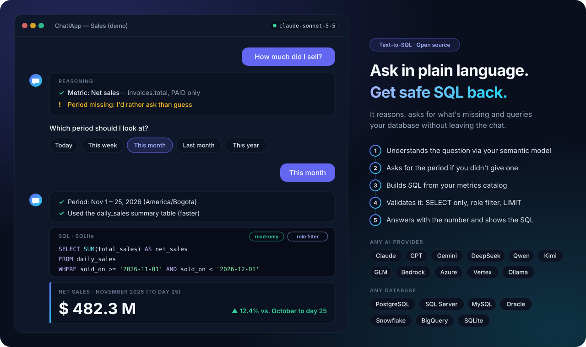
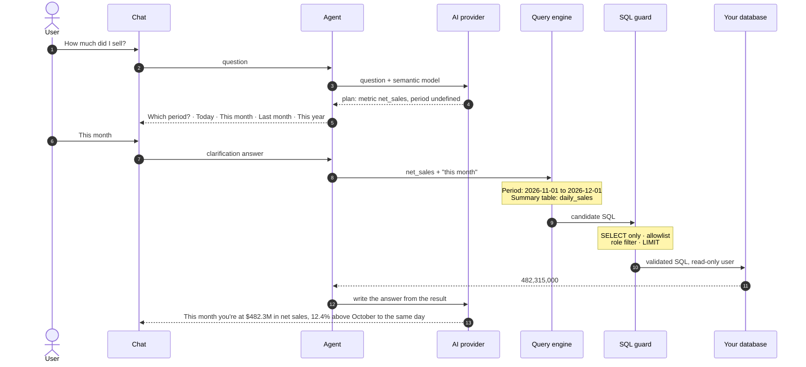
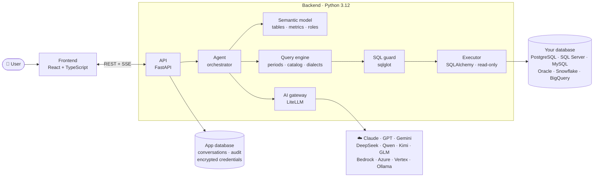
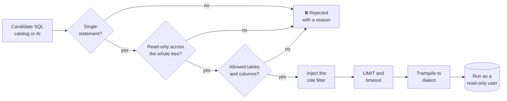

<div align="center">

[](README.md)
[](README.en.md)

<picture>
  <source media="(prefers-color-scheme: dark)" srcset="docs/assets/logo-dark.svg">
  
</picture>

### Ask your database the way you'd ask your best analyst.

ChatIApp is an AI chat that **reasons about your question, asks for what's missing and writes safe SQL** against your database, using the AI provider of your choice.

[](https://github.com/jmmana/ChatIApp/actions/workflows/ci.yml)
[](LICENSE)
[](#project-status)
[](docs/ARQUITECTURA.md)
[](docs/ARQUITECTURA.md)
[](docs/INTERFAZ.md)
[](CONTRIBUTING.md)



</div>

> [!NOTE]
> **Status: open design.** The architecture, roadmap and full backlog are published; coding starts with milestone [M0 · Foundations](https://github.com/jmmana/ChatIApp/milestone/1). This is the best moment to shape the design: comment on any [issue](https://github.com/jmmana/ChatIApp/issues) or ⭐ the repo to follow along.
>
> The detailed docs and the backlog are written in Spanish, the project's primary language. Questions and issues in English are welcome.

---

## Why it exists

A manager asks *"how much did we sell?"* and the answer takes days, because it depends on someone who knows SQL and knows the database. Text-to-SQL tools promise to fix that, but they **guess**: if you don't say the period they make one up, if they confuse a column they hand you a wrong number with full confidence, and they run whatever the model writes.

ChatIApp is built on three ideas:

1. **Ask instead of guessing.** If the period is missing, the metric is ambiguous or there are two "Bogotá" stores, ChatIApp asks, with one-click options. It also shows its reasoning: which metric it understood, which dates it computed and which table it used.
2. **The AI proposes, the engine decides.** The model understands intent and returns a structured plan. Dates are computed by deterministic code. SQL for your metrics is built by the engine from your catalog. And **every** SQL statement, wherever it comes from, goes through a guard that can't be talked out of its rules.
3. **Your AI, your database, your rules.** Claude, ChatGPT, Gemini, DeepSeek, Qwen or a local model; PostgreSQL, SQL Server, Oracle or BigQuery. You decide what the model sees, what each role sees and what gets audited.

## How a conversation flows



Every step streams to the chat **live** (Server-Sent Events): you watch the reasoning happen instead of a spinner.

## What it does

<table>
<tr>
<td width="50%" valign="top">

**🧠 Visible reasoning**<br/>
See every step: which metric it understood, which period it resolved, which summary table it used and why. If something looks off, you notice before trusting the number.

</td>
<td width="50%" valign="top">

**🛡️ Safe SQL by design**<br/>
`SELECT` only, verified on the full syntax tree with [sqlglot](https://github.com/tobymao/sqlglot). Allowlisted tables and columns, hidden personal data, injected role filters, `LIMIT` and timeouts.

</td>
</tr>
<tr>
<td valign="top">

**🗂️ Semantic model studio**<br/>
Upload your DDL, a data dictionary in Excel or CSV, or connect and read the structure. Describe your business and each column in your own words; the AI suggests what's missing and you approve it.

</td>
<td valign="top">

**📐 Metrics catalog**<br/>
Define "net sales" once and it's computed the same way every time, regardless of how a model interprets it. The engine uses your summary tables whenever they answer just as well, only faster.

</td>
</tr>
<tr>
<td valign="top">

**🔌 Any AI provider**<br/>
Claude, ChatGPT, Gemini, DeepSeek, Qwen, Kimi and GLM via direct API; or through Bedrock, Azure, Vertex AI, OpenRouter or GitHub Models; or locally with Ollama. A different model per task, with automatic fallback.

</td>
<td valign="top">

**🗄️ Any database**<br/>
PostgreSQL, SQL Server, MySQL, Oracle, Snowflake, BigQuery, SQLite and more via SQLAlchemy. Same flow, SQL in the right dialect, with the fine print handled (SQL Server dates, `TOP` vs `LIMIT`, `FETCH FIRST`).

</td>
</tr>
<tr>
<td valign="top">

**📅 Dates that don't break**<br/>
"This month", "last quarter", "last 30 days", "March 2025", "Q1": a deterministic resolver in Spanish and English that respects your time zone, week start and fiscal year.

</td>
<td valign="top">

**📊 Answers you can use**<br/>
The number on a card, the table, an automatic chart and the comparison with the previous period. CSV export, and the SQL always in view to copy.

</td>
</tr>
<tr>
<td valign="top">

**🔒 Your data stays home**<br/>
Choose whether the model sees only the schema, aggregated results too, or sample values as well. Credentials are stored encrypted and every question is audited.

</td>
<td valign="top">

**🧪 Measurable accuracy**<br/>
A golden question set compares providers on accuracy, cost and latency. Pick your model with data, not gut feeling.

</td>
</tr>
<tr>
<td valign="top">

**🧩 Embed it in your app**<br/>
Your backend asks through the `/api/v1` API with an API key, or your frontend embeds the chat with `<chatiapp-chat>`. Your login, your brand, your users; role filters apply just the same.

</td>
<td valign="top">

**📦 One container, your infrastructure**<br/>
A single image with SQLite: one `docker run` and you're done, or Kubernetes. PostgreSQL and Ollama are optional. Your data never goes through a third-party service.

</td>
</tr>
</table>

## Architecture



| Need | Library | What it solves |
|---|---|---|
| Many database engines | [SQLAlchemy 2](https://www.sqlalchemy.org/) | Connect, introspect and execute on MySQL, PostgreSQL, SQL Server, Oracle, Snowflake, BigQuery… with the same code |
| Validate and rewrite SQL per engine | [sqlglot](https://github.com/tobymao/sqlglot) | Confirms it's `SELECT` only, injects the role filter, applies the limit and transpiles to each dialect |
| Many AI providers | [LiteLLM](https://github.com/BerriAI/litellm) | One interface for Anthropic, OpenAI, Gemini, Bedrock, Azure, Vertex, Chinese and local models |
| Safe configuration | [Pydantic](https://docs.pydantic.dev/) | Validates each project's config and semantic model at startup |
| API | [FastAPI](https://fastapi.tiangolo.com/) | REST + SSE streaming, auto-generated OpenAPI |

## The SQL guard

AI can be wrong, and someone may try to trick it. So no SQL reaches your database without passing through here, not even SQL built by the engine itself:



A real role-filter rewrite (sqlglot output) for a manager who can only see branches 1 and 2:

```sql
-- What the AI proposed
SELECT s.name, SUM(i.total) FROM invoices i JOIN branches s ON s.id = i.branch_id GROUP BY 1

-- What actually runs
SELECT s.name, SUM(i.total)
FROM (SELECT * FROM invoices WHERE branch_id IN (1, 2)) AS i
JOIN branches AS s ON s.id = i.branch_id
GROUP BY 1
LIMIT 1000
```

The table is replaced by an already-filtered version, so the filter also applies inside subqueries and CTEs. And the guard walks the entire tree: it catches a `DELETE` hidden in a PostgreSQL CTE or a SQL Server `SELECT … INTO`, which look like reads at first glance.

> [!TIP]
> The guard is also a standalone library for any LLM app that executes SQL: **[sqlguardllm](https://github.com/jmmana/sqlguardllm)**, the SQL firewall for LLM apps.

## AI providers

| Type | Providers | How it connects |
|---|---|---|
| **Direct API** | Anthropic (Claude) · OpenAI (ChatGPT) · Google Gemini · Mistral · xAI (Grok) · Groq | API key |
| **Cloud platforms** | AWS Bedrock · Azure OpenAI / AI Foundry · Google Vertex AI · OpenRouter · GitHub Models | Platform credentials (IAM, endpoint + key, service account, token) |
| **Chinese models** | DeepSeek · Qwen (Alibaba Model Studio) · Kimi (Moonshot) · GLM (Zhipu / Z.ai) · MiniMax · Doubao (Volcengine) | API key, international or mainland China endpoint |
| **Local** | Ollama · vLLM · LM Studio · any OpenAI-compatible server | Server URL, no data leaves your network |

Configure them from a gallery with a guided form and a **Test connection** button, or as code in [`chatiapp.yaml`](examples/chatiapp.example.yaml). Use a strong model to reason and a cheap one to write the answer.

## Databases

| Engine | Dialect | Driver |
|---|---|---|
| PostgreSQL / Amazon Redshift | `postgres` / `redshift` | psycopg |
| Microsoft SQL Server / Azure SQL | `tsql` | pyodbc |
| MySQL / MariaDB | `mysql` | PyMySQL |
| Oracle | `oracle` | python-oracledb |
| Snowflake | `snowflake` | snowflake-sqlalchemy |
| Google BigQuery | `bigquery` | sqlalchemy-bigquery |
| SQLite (demo and tests) | `sqlite` | built in |

## Your business, explained in one file

The semantic model is everything ChatIApp knows about your database. Build it in the UI (import DDL, a data dictionary, or read the connected database) or version it as YAML next to your code:

```yaml
metrics:
  - name: net_sales
    label: Net sales
    synonyms: [sales, how much did I sell, revenue, billing]
    table: invoices
    expression: SUM(total)
    time_column: issued_on
    filters: ["status = 'PAID'"]
    requires_period: true          # if no period is given, ask for it
    dimensions: [branches.name, invoices.channel, customers.segment]

summary_tables:
  - table: monthly_sales
    grain: month
    includes_current_period: false # loaded at month close: can't answer "this month"
    metrics:
      net_sales: SUM(total_sales)
```

The bundled demo dataset uses Spanish names (`facturas`, `ventas_diarias`…); snippets here are translated for readability. Full example: [`examples/ventas/semantic-model.yaml`](examples/ventas/semantic-model.yaml).

## Embed it in your app

ChatIApp doesn't have to be yet another tab for your users: it can live inside your product.

| Mode | Who calls | Credential |
|---|---|---|
| **Full app** | People, through the ChatIApp UI | Username and password |
| **Headless API** | Your backend: asks and gets SQL, result and answer back | **Server API key** with scopes, allowed data sources and roles |
| **Embedded chat** | Your frontend, with your colors and your users | **15-minute session token** issued by your backend; the API key never reaches the browser |

```html
<script src="https://chatiapp.yourcompany.com/embed/v1/chatiapp.js" defer></script>
<chatiapp-chat base-url="https://chatiapp.yourcompany.com" lang="en" theme="auto"></chatiapp-chat>
```

Your backend states on whose behalf each question is asked (`id`, `role`, `attributes`) and ChatIApp applies that user's role filters, within the ceiling set by the API key. Full flow, backend examples, Python and TypeScript SDKs and deployment next to your app: [docs/INTEGRACION.md](docs/INTEGRACION.md) (Spanish).

## Project status

ChatIApp is in **open design**: documentation and backlog are complete and development proceeds by milestones. Every task is an issue with a goal, verifiable acceptance criteria, files and size.

| Milestone | Delivers | Epics |
|---|---|---|
| [**M0 · Foundations**](https://github.com/jmmana/ChatIApp/milestone/1) | Backend and frontend that build, CI, single image with SQLite, app database, validated config, demo dataset | [#1](https://github.com/jmmana/ChatIApp/issues/1) |
| [**M1 · MVP "How much did I sell?"**](https://github.com/jmmana/ChatIApp/milestone/2) | End to end with one provider: semantic model, query engine, agent with clarifications, chat with visible reasoning | [#2](https://github.com/jmmana/ChatIApp/issues/2) [#3](https://github.com/jmmana/ChatIApp/issues/3) [#4](https://github.com/jmmana/ChatIApp/issues/4) [#6](https://github.com/jmmana/ChatIApp/issues/6) |
| [**M2 · Any AI**](https://github.com/jmmana/ChatIApp/milestone/3) | Full provider hub: direct API, platforms, Chinese and local models; per-task routing | [#5](https://github.com/jmmana/ChatIApp/issues/5) |
| [**M3 · Enterprise-ready**](https://github.com/jmmana/ChatIApp/milestone/4) | Login and roles, role filters from user attributes, audit log, privacy levels, and embedding into other apps: API keys, embeddable chat and SDKs | [#7](https://github.com/jmmana/ChatIApp/issues/7) [#82](https://github.com/jmmana/ChatIApp/issues/82) |
| [**M4 · Measurable quality**](https://github.com/jmmana/ChatIApp/milestone/5) | Evaluation set, model comparison, observability, multi-engine tests, v1.0 | [#8](https://github.com/jmmana/ChatIApp/issues/8) [#9](https://github.com/jmmana/ChatIApp/issues/9) |

Detailed plan in [docs/ROADMAP.md](docs/ROADMAP.md) and live progress on the [project board](https://github.com/users/jmmana/projects/2).

## Quick start

> [!IMPORTANT]
> Available from **v0.1** (end of milestone M1). This is how it will look:

```bash
docker run -p 8080:8080 -v chatiapp:/data \
  -e CHATIAPP_ADMIN_EMAIL=you@example.com -e CHATIAPP_ADMIN_PASSWORD='a-long-password' \
  -e ANTHROPIC_API_KEY=sk-ant-… ghcr.io/jmmana/chatiapp
# open http://localhost:8080 and ask: how much did I sell?
```

Everything lives in the `chatiapp` volume (SQLite database, demo and encryption key). For PostgreSQL or Ollama, use the profiles in [`docker-compose.yml`](docker-compose.yml).

## Documentation (Spanish)

[Vision](docs/VISION.md) · [Architecture](docs/ARQUITECTURA.md) · [Conversation flow](docs/FLUJO_CONVERSACIONAL.md) · [Semantic model](docs/MODELO_SEMANTICO.md) · [AI providers](docs/PROVEEDORES_IA.md) · [Databases](docs/BASES_DE_DATOS.md) · [Security](docs/SEGURIDAD.md) · [UI](docs/INTERFAZ.md) · [Integration](docs/INTEGRACION.md) · [API](docs/API.md) · [ADRs](docs/adr/)

## Contributing · Security · License

Ideas and design critique are welcome right now, before code exists: see [CONTRIBUTING.md](CONTRIBUTING.md). Report vulnerabilities privately as described in [SECURITY.md](SECURITY.md). Licensed under [Apache-2.0](LICENSE) © 2026 Juan Castillo.
