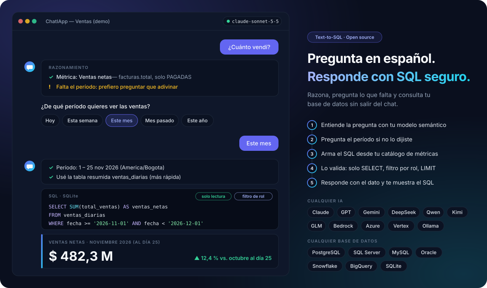
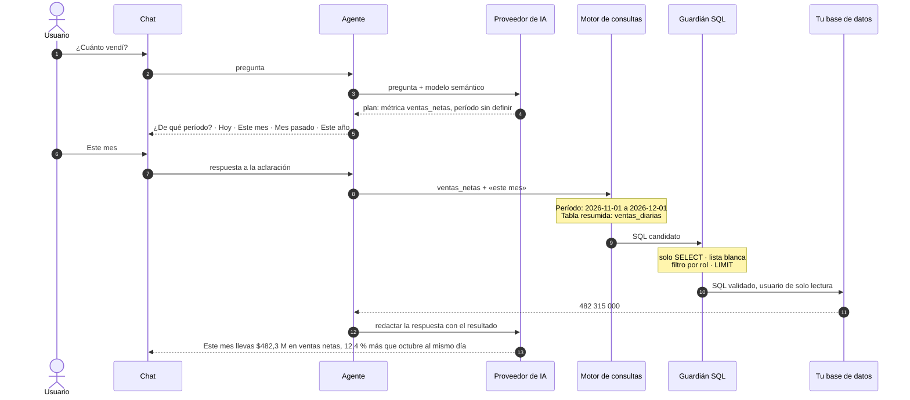
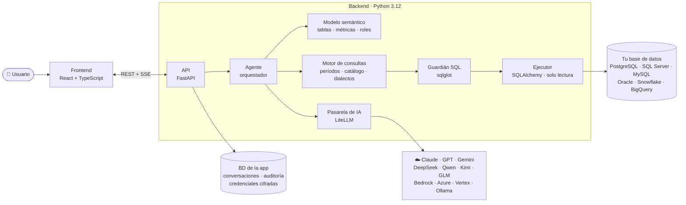
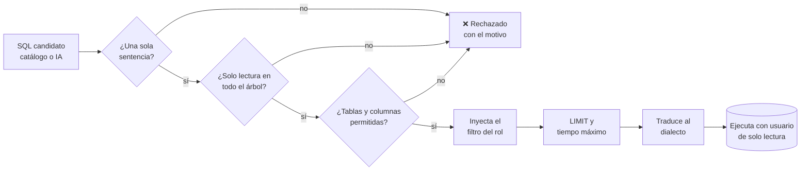

<div align="center">

[](README.md)
[](README.en.md)

<picture>
  <source media="(prefers-color-scheme: dark)" srcset="docs/assets/logo-dark.svg">
  
</picture>

### Pregúntale a tu base de datos como le preguntarías a tu mejor analista.

ChatIApp es un chat de IA que **razona tu pregunta, te pide lo que falta y escribe SQL seguro** sobre tu base de datos, con el proveedor de IA que tú elijas.

[](https://github.com/jmmana/ChatIApp/actions/workflows/ci.yml)
[](LICENSE)
[](#estado-del-proyecto)
[](docs/ARQUITECTURA.md)
[](docs/ARQUITECTURA.md)
[](docs/INTERFAZ.md)
[](CONTRIBUTING.md)



</div>

> [!NOTE]
> **Estado: diseño abierto.** La arquitectura, el roadmap y el backlog completo ya están publicados; el código empieza con el hito [M0 · Fundaciones](https://github.com/jmmana/ChatIApp/milestone/1). Es el mejor momento para opinar sobre el diseño: comenta en cualquier [issue](https://github.com/jmmana/ChatIApp/issues) o dale ⭐ para seguir el avance.

---

## Por qué existe

Un gerente pregunta *«¿cuánto vendimos?»* y la respuesta tarda días, porque depende de alguien que sepa SQL y conozca la base. Las herramientas de *text-to-SQL* prometen resolverlo, pero **adivinan**: si no dices el período inventan uno, si confunden una columna te dan un número equivocado con total seguridad, y ejecutan lo que el modelo escriba.

ChatIApp parte de tres ideas:

1. **Preguntar antes de adivinar.** Si falta el período, la métrica es ambigua o hay dos tiendas «Bogotá», ChatIApp pregunta con opciones de un clic. Y te muestra su razonamiento: qué métrica entendió, qué fechas calculó y qué tabla usó.
2. **La IA propone, el motor dispone.** El modelo de IA entiende la intención y devuelve un plan estructurado. Las fechas las calcula código determinista. El SQL de tus métricas lo arma el motor desde tu catálogo. Y **todo** SQL, venga de donde venga, pasa por un guardián que no se deja convencer.
3. **Tu IA, tu base, tus reglas.** Claude, ChatGPT, Gemini, DeepSeek, Qwen o un modelo local; PostgreSQL, SQL Server, Oracle o BigQuery. Tú decides qué ve el modelo, qué ve cada rol y qué se audita.

## Así fluye una conversación



Cada paso llega al chat **en vivo** (Server-Sent Events): ves el razonamiento mientras ocurre, no un spinner. Detalle del flujo, de las reglas para pedir aclaraciones y de cómo se resuelven las fechas en [docs/FLUJO_CONVERSACIONAL.md](docs/FLUJO_CONVERSACIONAL.md).

## Qué hace

<table>
<tr>
<td width="50%" valign="top">

**🧠 Razonamiento visible**<br/>
Ves cada paso: qué métrica entendió, qué período resolvió, qué tabla resumida usó y por qué. Si algo no cuadra, lo notas antes de confiar en el número.

</td>
<td width="50%" valign="top">

**🛡️ SQL seguro por diseño**<br/>
Solo `SELECT`, verificado sobre el árbol sintáctico completo con [sqlglot](https://github.com/tobymao/sqlglot). Tablas y columnas en lista blanca, datos personales ocultos, filtro por rol inyectado, `LIMIT` y tiempo máximo.

</td>
</tr>
<tr>
<td valign="top">

**🗂️ Estudio del modelo semántico**<br/>
Sube tu DDL, un diccionario de datos en Excel o CSV, o conecta la base y lee la estructura. Explica tu negocio y cada columna con tus palabras; la IA sugiere lo que falta y tú lo apruebas.

</td>
<td valign="top">

**📐 Catálogo de métricas**<br/>
Defines «ventas netas» una vez y se calcula igual siempre, sin depender de cómo la interprete el modelo. El motor usa tus tablas resumidas cuando responden igual de bien y más rápido.

</td>
</tr>
<tr>
<td valign="top">

**🔌 Cualquier proveedor de IA**<br/>
Claude, ChatGPT, Gemini, DeepSeek, Qwen, Kimi y GLM por API directa; o a través de Bedrock, Azure, Vertex AI, OpenRouter o GitHub Models; o local con Ollama. Un modelo distinto para cada tarea, con respaldo automático si uno falla.

</td>
<td valign="top">

**🗄️ Cualquier base de datos**<br/>
PostgreSQL, SQL Server, MySQL, Oracle, Snowflake, BigQuery, SQLite y más vía SQLAlchemy. Mismo flujo, SQL en el dialecto correcto, con los detalles finos resueltos (fechas en SQL Server, `TOP` contra `LIMIT`, `FETCH FIRST`).

</td>
</tr>
<tr>
<td valign="top">

**📅 Fechas que no fallan**<br/>
«Este mes», «el trimestre pasado», «últimos 30 días», «marzo de 2025», «Q1»: un resolutor determinista en español e inglés con tu zona horaria, tu inicio de semana y tu año fiscal.

</td>
<td valign="top">

**📊 Respuestas que sirven**<br/>
El dato en una tarjeta, la tabla, un gráfico automático y la comparación con el período anterior. Exportación a CSV y el SQL siempre a la vista para copiarlo.

</td>
</tr>
<tr>
<td valign="top">

**🔒 Tus datos se quedan en casa**<br/>
Tú decides si el modelo de IA ve solo el esquema, también los resultados agregados o además valores de muestra. Las credenciales se guardan cifradas y cada pregunta queda auditada.

</td>
<td valign="top">

**🧪 Precisión que se mide**<br/>
Un set de preguntas doradas compara proveedores en exactitud, costo y latencia. Eliges el modelo con datos, no por intuición.

</td>
</tr>
<tr>
<td valign="top">

**🧩 Intégralo en tu app**<br/>
Tu backend pregunta por la API `/api/v1` con una API key, o tu frontend embebe el chat con `<chatiapp-chat>`. Tu login, tu marca, tus usuarios; los filtros por rol se aplican igual.

</td>
<td valign="top">

**📦 Un contenedor, tu infraestructura**<br/>
`docker compose up` o Kubernetes. Para integrar sin interfaz basta la imagen `chatiapp-api` y una base PostgreSQL. Tus datos nunca pasan por un servicio de terceros.

</td>
</tr>
</table>

## Arquitectura



| Necesidad | Librería | Qué resuelve |
|---|---|---|
| Muchos motores de base | [SQLAlchemy 2](https://www.sqlalchemy.org/) | Conexión, introspección y ejecución en MySQL, PostgreSQL, SQL Server, Oracle, Snowflake, BigQuery… con el mismo código |
| Validar y reescribir SQL por motor | [sqlglot](https://github.com/tobymao/sqlglot) | Confirma que es solo `SELECT`, inyecta el filtro del rol, aplica el límite y lo traduce al dialecto de cada motor |
| Muchos proveedores de IA | [LiteLLM](https://github.com/BerriAI/litellm) | Una sola interfaz para Anthropic, OpenAI, Gemini, Bedrock, Azure, Vertex, modelos chinos y locales |
| Configuración segura | [Pydantic](https://docs.pydantic.dev/) | Valida la configuración y el modelo semántico de cada proyecto al arrancar |
| API | [FastAPI](https://fastapi.tiangolo.com/) | REST + streaming SSE, OpenAPI autogenerado |

Componentes, modelo de datos, decisiones de diseño y estructura del repo en [docs/ARQUITECTURA.md](docs/ARQUITECTURA.md).

## El guardián de SQL

La IA puede equivocarse, y alguien puede intentar engañarla. Por eso ningún SQL llega a tu base sin pasar por aquí, ni siquiera el que arma el propio motor:



Un ejemplo real del filtro por rol (salida de sqlglot) para un gerente que solo ve las sucursales 1 y 2:

```sql
-- Lo que propuso la IA
SELECT s.nombre, SUM(f.total) FROM facturas f JOIN sucursales s ON s.id = f.sucursal_id GROUP BY 1

-- Lo que se ejecuta
SELECT s.nombre, SUM(f.total)
FROM (SELECT * FROM facturas WHERE sucursal_id IN (1, 2)) AS f
JOIN sucursales AS s ON s.id = f.sucursal_id
GROUP BY 1
LIMIT 1000
```

La tabla se reemplaza por una versión ya filtrada, así que el filtro aplica también dentro de subconsultas y CTE. Y el guardián recorre el árbol completo: detecta un `DELETE` escondido en un CTE de PostgreSQL o un `SELECT … INTO` de SQL Server, que a simple vista parecen consultas de lectura. Modelo de amenazas completo en [docs/SEGURIDAD.md](docs/SEGURIDAD.md).

## Proveedores de IA

| Tipo | Proveedores | Cómo se conecta |
|---|---|---|
| **API directa** | Anthropic (Claude) · OpenAI (ChatGPT) · Google Gemini · Mistral · xAI (Grok) · Groq | API key |
| **Plataformas cloud** | AWS Bedrock · Azure OpenAI / AI Foundry · Google Vertex AI · OpenRouter · GitHub Models | Credenciales de la plataforma (IAM, endpoint + key, cuenta de servicio, token) |
| **Modelos chinos** | DeepSeek · Qwen (Alibaba Model Studio) · Kimi (Moonshot) · GLM (Zhipu / Z.ai) · MiniMax · Doubao (Volcengine) | API key, con endpoint internacional o de China continental |
| **Local** | Ollama · vLLM · LM Studio · cualquier servidor compatible con OpenAI | URL del servidor, sin datos fuera de tu red |

Todos se configuran desde una galería con formulario guiado y botón **Probar conexión**, o como código en [`chatiapp.yaml`](examples/chatiapp.example.yaml). Puedes asignar un modelo potente para razonar y uno económico para redactar. Campos por proveedor, la situación de GitHub Copilot y las reglas de privacidad en [docs/PROVEEDORES_IA.md](docs/PROVEEDORES_IA.md).

## Bases de datos

| Motor | Dialecto | Driver |
|---|---|---|
| PostgreSQL / Amazon Redshift | `postgres` / `redshift` | psycopg |
| Microsoft SQL Server / Azure SQL | `tsql` | pyodbc |
| MySQL / MariaDB | `mysql` | PyMySQL |
| Oracle | `oracle` | python-oracledb |
| Snowflake | `snowflake` | snowflake-sqlalchemy |
| Google BigQuery | `bigquery` | sqlalchemy-bigquery |
| SQLite (demo y pruebas) | `sqlite` | incluido |

Diferencias de dialecto que el motor resuelve por ti y cómo crear un usuario de solo lectura en cada motor: [docs/BASES_DE_DATOS.md](docs/BASES_DE_DATOS.md).

## Tu negocio, explicado en un archivo

El modelo semántico es lo que ChatIApp sabe de tu base. Lo armas desde la interfaz (importando DDL, un diccionario o leyendo la base conectada) o lo versionas como YAML junto a tu código:

```yaml
metrics:
  - name: ventas_netas
    label: Ventas netas
    synonyms: [ventas, cuánto vendí, facturación, ingresos]
    table: facturas
    expression: SUM(total)
    time_column: fecha
    filters: ["estado = 'PAGADA'"]
    requires_period: true          # si no dicen el período, se pregunta
    dimensions: [sucursales.nombre, facturas.canal, clientes.segmento]

summary_tables:
  - table: ventas_mensuales
    grain: month
    includes_current_period: false # se carga al cierre: no sirve para «este mes»
    metrics:
      ventas_netas: SUM(total_ventas)
```

Ejemplo completo: [`examples/ventas/semantic-model.yaml`](examples/ventas/semantic-model.yaml). Referencia de campos y reglas: [docs/MODELO_SEMANTICO.md](docs/MODELO_SEMANTICO.md).

## Intégralo en tu app

ChatIApp no tiene que ser otra pestaña para tus usuarios: puede vivir dentro de tu producto.

| Modo | Quién llama | Credencial |
|---|---|---|
| **App completa** | Personas, desde la interfaz de ChatIApp | Usuario y contraseña |
| **API sin interfaz** | Tu backend: pregunta y recibe SQL, resultado y respuesta | **API key de servidor** con alcances, fuentes y roles permitidos |
| **Chat embebido** | Tu frontend, con tus colores y tus usuarios | **Token de sesión** de 15 minutos que emite tu backend; la API key nunca llega al navegador |

```html
<script src="https://chatiapp.tuempresa.com/embed/v1/chatiapp.js" defer></script>
<chatiapp-chat base-url="https://chatiapp.tuempresa.com" lang="es" theme="auto"></chatiapp-chat>
```

Tu backend dice en nombre de qué usuario se pregunta (`id`, `role`, `attributes`) y ChatIApp aplica sus filtros por rol, dentro del techo que fija la API key. Flujo completo, ejemplos de backend, SDKs de Python y TypeScript y despliegue junto a tu app: [docs/INTEGRACION.md](docs/INTEGRACION.md).

## Estado del proyecto

ChatIApp está en **diseño abierto**: la documentación y el backlog están completos y el desarrollo avanza por hitos. Cada tarea es un issue con objetivo, criterios de aceptación verificables, archivos y tamaño.

| Hito | Qué entrega | Épicas |
|---|---|---|
| [**M0 · Fundaciones**](https://github.com/jmmana/ChatIApp/milestone/1) | Backend y frontend que compilan, CI, Docker, BD de la app, configuración validada, dataset demo | [#1](https://github.com/jmmana/ChatIApp/issues/1) |
| [**M1 · MVP «¿Cuánto vendí?»**](https://github.com/jmmana/ChatIApp/milestone/2) | De punta a punta con un proveedor: modelo semántico, motor de consultas, agente con aclaraciones, chat con razonamiento visible | [#2](https://github.com/jmmana/ChatIApp/issues/2) [#3](https://github.com/jmmana/ChatIApp/issues/3) [#4](https://github.com/jmmana/ChatIApp/issues/4) [#6](https://github.com/jmmana/ChatIApp/issues/6) |
| [**M2 · Cualquier IA**](https://github.com/jmmana/ChatIApp/milestone/3) | Hub completo de proveedores: API directa, plataformas, modelos chinos y locales; enrutamiento por tarea | [#5](https://github.com/jmmana/ChatIApp/issues/5) |
| [**M3 · Listo para empresa**](https://github.com/jmmana/ChatIApp/milestone/4) | Login y roles, filtros por rol con atributos del usuario, auditoría, niveles de privacidad, y la integración en otras apps: API keys, chat embebible y SDKs | [#7](https://github.com/jmmana/ChatIApp/issues/7) [#82](https://github.com/jmmana/ChatIApp/issues/82) |
| [**M4 · Calidad medible**](https://github.com/jmmana/ChatIApp/milestone/5) | Set de evaluación, comparativa de modelos, observabilidad, pruebas multimotor, v1.0 | [#8](https://github.com/jmmana/ChatIApp/issues/8) [#9](https://github.com/jmmana/ChatIApp/issues/9) |

Plan detallado en [docs/ROADMAP.md](docs/ROADMAP.md) y avance en vivo en el [tablero del proyecto](https://github.com/users/jmmana/projects/2).

## Inicio rápido

> [!IMPORTANT]
> Disponible a partir de **v0.1** (fin del hito M1). Así se verá:

```bash
git clone https://github.com/jmmana/ChatIApp.git && cd ChatIApp
cp .env.example .env          # agrega al menos una API key, o usa Ollama
docker compose up
# abre http://localhost:8080 y pregunta: ¿cuánto vendí?
```

La demo trae una base de ventas de ejemplo con su modelo semántico, para probar sin conectar nada tuyo.

## Documentación

| Documento | Para qué |
|---|---|
| [Visión](docs/VISION.md) | Problema, usuarios, alcance y qué **no** es ChatIApp |
| [Arquitectura](docs/ARQUITECTURA.md) | Componentes, secuencias, modelo de datos, estructura del repo |
| [Flujo conversacional](docs/FLUJO_CONVERSACIONAL.md) | Estados del agente, cuándo pregunta, cómo resuelve fechas, eventos SSE |
| [Modelo semántico](docs/MODELO_SEMANTICO.md) | Formatos de importación, métricas, tablas resumidas, roles |
| [Proveedores de IA](docs/PROVEEDORES_IA.md) | Catálogo, credenciales, enrutamiento, privacidad |
| [Bases de datos](docs/BASES_DE_DATOS.md) | Motores, dialectos, usuario de solo lectura |
| [Seguridad](docs/SEGURIDAD.md) | Modelo de amenazas y capas de defensa |
| [Interfaz](docs/INTERFAZ.md) | Pantallas, principios de diseño, accesibilidad |
| [Integración](docs/INTEGRACION.md) | API keys, chat embebido, SDKs y despliegue junto a tu app |
| [API](docs/API.md) | Endpoints REST `/api/v1` y eventos de streaming |
| [Decisiones (ADR)](docs/adr/) | Por qué LiteLLM, sqlglot, SSE, tabla derivada para roles… |

## Contribuir

Las ideas, dudas y críticas al diseño son bienvenidas ahora mismo, antes de escribir código. Lee [CONTRIBUTING.md](CONTRIBUTING.md) para ver cómo se escriben los issues (objetivo, criterios verificables, archivos, tamaño) y cómo se trabaja una tarea.

## Seguridad

Si encuentras una vulnerabilidad, **no abras un issue público**: repórtala en privado como se explica en [SECURITY.md](SECURITY.md).

## Licencia

[Apache-2.0](LICENSE) © 2026 Juan Castillo
