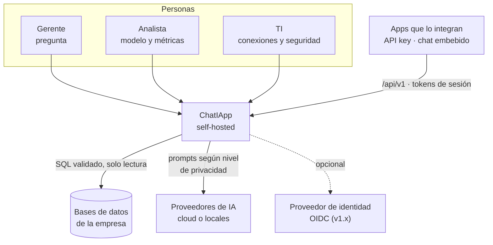
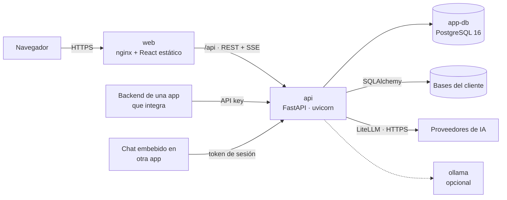
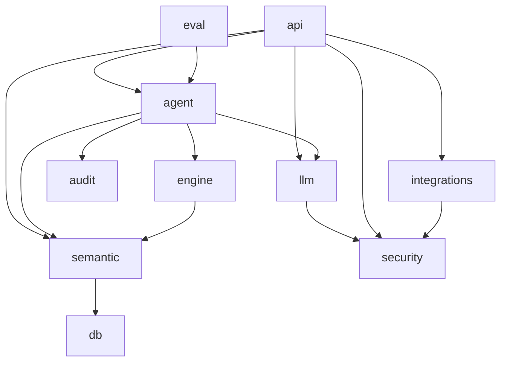
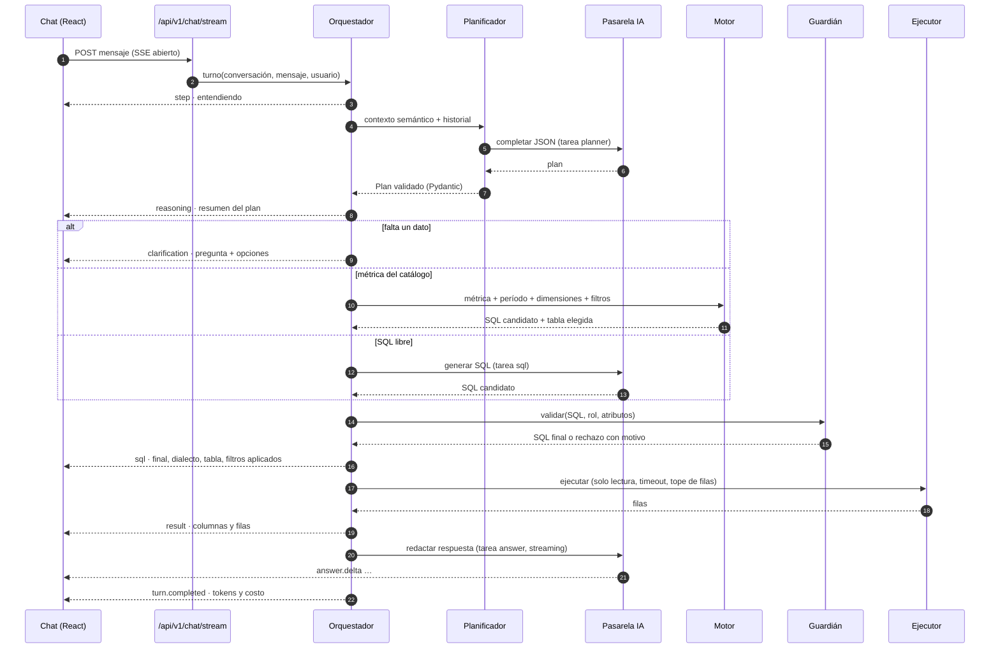
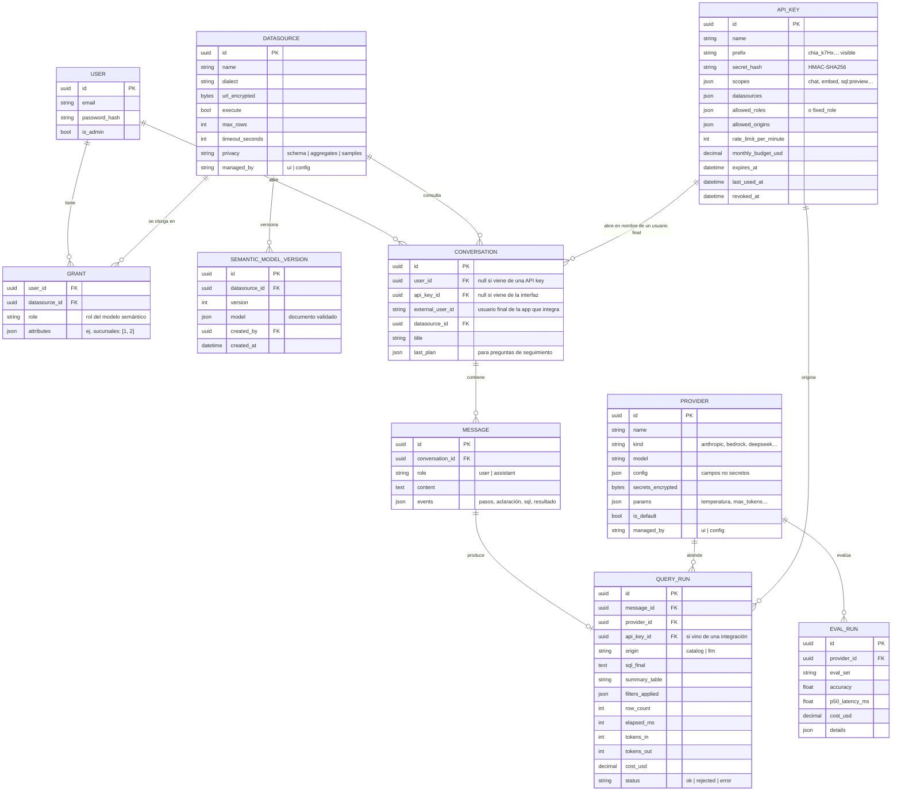

# Arquitectura

> Estado: **diseño**. Este documento es el contrato que siguen las tareas del backlog. Si una tarea necesita apartarse de él, se actualiza aquí primero (o se escribe un ADR).

## Principios

| Principio | En la práctica |
|---|---|
| **La IA propone, el motor dispone** | El modelo de IA devuelve un *plan* estructurado (JSON validado con Pydantic). Fechas, SQL de métricas, permisos y límites los resuelve código determinista. Ver [ADR 0001](adr/0001-la-ia-propone-el-motor-dispone.md) |
| **Un único punto de control** | Todo SQL, del catálogo o de la IA, pasa por el guardián antes de ejecutarse. No hay atajos |
| **Configuración validada al arrancar** | `chatiapp.yaml` y cada modelo semántico se validan con Pydantic; un error impide arrancar y dice dónde está |
| **Proveedores y motores intercambiables** | LiteLLM para IA, SQLAlchemy + sqlglot para bases. Agregar uno es configuración, no código |
| **Streaming de punta a punta** | El agente emite eventos tipados; la API los entrega por SSE; la interfaz los pinta en vivo |

## Contexto



## Contenedores



| Contenedor | Tecnología | Responsabilidad |
|---|---|---|
| `web` | React 19 + TypeScript + Vite + Tailwind + shadcn/ui, servido por nginx | Interfaz. nginx también hace de proxy de `/api` con el buffering apagado para SSE |
| `api` | Python 3.12, FastAPI, uvicorn | Toda la lógica: agente, motor, guardián, pasarela de IA, administración. También sirve el script del chat embebido (`/embed/v1/chatiapp.js`), así que basta este contenedor para integrar ChatIApp sin la interfaz completa |
| `app-db` | PostgreSQL 16 (SQLite en desarrollo) | Configuración, modelos semánticos versionados, conversaciones, auditoría, credenciales cifradas |
| `ollama` | Ollama | Opcional, para correr modelos locales en el mismo `docker compose` |

## Componentes del backend

| Módulo | Responsabilidad | Librerías |
|---|---|---|
| `app/settings` | Variables de entorno (Pydantic Settings) y carga de `chatiapp.yaml` con interpolación `${VAR}` | pydantic-settings, PyYAML |
| `app/db` | Modelos ORM y sesiones de la BD de la app; migraciones | SQLAlchemy 2, Alembic |
| `app/security` | Cifrado de credenciales (Fernet con rotación), enmascarado, autenticación y roles | cryptography |
| `app/semantic` | Esquema del modelo semántico, importadores (DDL, diccionario, YAML), introspección, fusión, contexto para prompts, sugerencias con IA | Pydantic, sqlglot, SQLAlchemy, openpyxl |
| `app/engine` | Resolutor de períodos, catálogo de métricas, constructor SQL por dialecto, enrutamiento a tablas resumidas, guardián, ejecutor | sqlglot, SQLAlchemy |
| `app/llm` | Catálogo de proveedores, pasarela (completar, JSON, streaming), prueba de conexión, enrutamiento por tarea y respaldo | LiteLLM, httpx |
| `app/agent` | Planificador, orquestador (máquina de estados), aclaraciones, SQL libre con reparación, redacción de la respuesta, eventos | — |
| `app/integrations` | API keys (hash, alcances, techo de roles), identidad del usuario final, tokens de sesión del chat embebido, CORS por origen | PyJWT |
| `app/api` | Routers REST bajo `/api/v1` y endpoint SSE | FastAPI |
| `app/audit` | Registro de cada turno: pregunta, plan, SQL, filas, proveedor, tokens, costo | — |
| `app/eval` | Runner del set dorado y reportes por modelo | — |

### Dependencias entre módulos



`engine` no depende de `llm`: el motor es 100 % determinista y se prueba sin red. `agent` es el único módulo que combina IA y motor.

## Secuencia de un turno



Eventos y su contenido: [FLUJO_CONVERSACIONAL.md](FLUJO_CONVERSACIONAL.md#eventos-de-streaming).

## Modelo de datos de la app



El modelo semántico se guarda como **documento versionado** (JSON validado) y no como tablas normalizadas: se edita como un todo, se importa y exporta como YAML y cada cambio deja una versión a la que se puede volver. Ver [ADR 0005](adr/0005-modelo-semantico-como-documento.md).

## Estructura del repositorio (objetivo)

```text
ChatIApp/
├── backend/
│   ├── pyproject.toml            # uv, ruff, pytest, mypy
│   ├── alembic/                  # migraciones de la BD de la app
│   ├── app/
│   │   ├── main.py               # FastAPI: routers, CORS, lifespan
│   │   ├── settings/             # entorno + chatiapp.yaml
│   │   ├── db/                   # ORM y sesiones
│   │   ├── security/             # cifrado, auth, roles
│   │   ├── semantic/             # schema, importers/, introspect, merge, context, suggest
│   │   ├── engine/               # periods, catalog, dialects, builder, summary, guard, executor
│   │   ├── llm/                  # catalog, gateway, routing
│   │   ├── agent/                # plan, planner, orchestrator, clarify, answer, events
│   │   ├── api/                  # routers /api/v1: health, datasources, semantic, providers, chat…
│   │   ├── integrations/         # API keys, usuario final, tokens de sesión, CORS
│   │   ├── audit/
│   │   └── eval/
│   └── tests/                    # espejo de app/; fixtures con la demo SQLite
├── frontend/
│   ├── package.json              # pnpm, Vite, Vitest, ESLint
│   └── src/
│       ├── app/                  # rutas, layout, proveedores de contexto
│       ├── components/ui/        # shadcn/ui
│       ├── features/
│       │   ├── chat/             # SSE, mensajes, razonamiento, SQL, resultados
│       │   ├── semantic/         # estudio del modelo
│       │   ├── providers/        # hub de proveedores
│       │   ├── integrations/     # administración de API keys
│       │   └── datasources/
│       └── lib/                  # cliente API tipado, utilidades
├── embed/                        # chat embebible: web component + paquete React
├── sdks/
│   ├── python/                   # cliente generado desde OpenAPI
│   └── typescript/
├── examples/                     # modelo semántico, diccionario y DDL de la demo; app anfitriona de ejemplo
├── evals/                        # set dorado (YAML)
├── docs/
├── docker-compose.yml
└── .github/workflows/ci.yml
```

## Requisitos no funcionales

| Atributo | Objetivo |
|---|---|
| Latencia | Primer evento SSE < 500 ms; respuesta p50 < 8 s con proveedor cloud |
| Seguridad | Cero SQL de escritura ejecutado (suite adversarial en CI); credenciales cifradas en reposo; nada secreto en logs |
| Portabilidad | Mismo flujo en los 7 dialectos soportados; pruebas de integración con contenedores para PostgreSQL, MySQL y SQL Server |
| Observabilidad | Logs JSON con id de turno; trazas OpenTelemetry por turno; costo y tokens por consulta |
| Pruebas | El motor (`engine`) se prueba sin red ni IA; el agente con un proveedor simulado determinista |
| Accesibilidad | WCAG 2.2 AA en la interfaz; todo usable con teclado |
| Idiomas | Interfaz y resolutor de períodos en español e inglés |

## Decisiones de arquitectura

| ADR | Decisión |
|---|---|
| [0001](adr/0001-la-ia-propone-el-motor-dispone.md) | La IA devuelve un plan estructurado; el motor determinista calcula fechas y arma el SQL de métricas |
| [0002](adr/0002-litellm-como-pasarela-de-ia.md) | LiteLLM como pasarela única de proveedores de IA |
| [0003](adr/0003-sqlglot-como-guardian-y-traductor.md) | sqlglot como guardián (AST) y traductor de dialectos |
| [0004](adr/0004-filtro-por-rol-como-tabla-derivada.md) | El filtro por rol reemplaza la tabla por una tabla derivada filtrada |
| [0005](adr/0005-modelo-semantico-como-documento.md) | El modelo semántico se guarda como documento versionado |
| [0006](adr/0006-sse-para-streaming.md) | Server-Sent Events para el streaming del turno |
