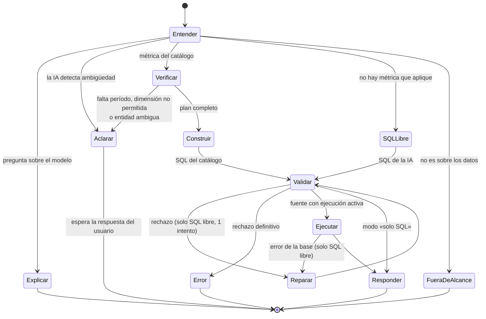

# Flujo conversacional

Cómo ChatIApp pasa de *«¿cuánto vendí?»* a una respuesta confiable: los estados del agente, el contrato del plan, cuándo pregunta, cómo resuelve las fechas y qué eventos ve la interfaz.

## Estados del agente



- **Entender** es la única llamada obligatoria a la IA. Devuelve un plan; no devuelve SQL salvo en la ruta libre.
- **Verificar** es código: comprueba que la métrica existe, que las dimensiones y filtros están permitidos, que el período se puede resolver y que las entidades nombradas existen.
- **Construir** no usa IA: el SQL de una métrica del catálogo es siempre el mismo para la misma pregunta.
- **Reparar** solo existe para SQL de la IA, una vez, con el mensaje de error exacto del guardián o de la base.

## El plan

La salida de **Entender** es un JSON que se valida con Pydantic. Si no es JSON válido o no cumple el esquema, se reintenta una vez con el error; si vuelve a fallar, el turno termina con un error claro.

```json
{
  "intent": "metric",
  "reasoning": "Preguntan cuánto vendieron: es la métrica ventas_netas (sinónimo «cuánto vendí»). No mencionan período.",
  "metric": "ventas_netas",
  "dimensions": [],
  "filters": [],
  "time_grain": null,
  "period_text": null,
  "compare_previous": false,
  "order": null,
  "limit": null,
  "clarification": null,
  "sql": null,
  "answer": null
}
```

| Campo | Tipo | Notas |
|---|---|---|
| `intent` | `metric` · `sql` · `clarify` · `explain` · `out_of_scope` | Qué ruta sigue el turno |
| `reasoning` | texto | Resumen breve y visible para el usuario. No es la cadena de pensamiento del modelo |
| `metric` | nombre del catálogo | Debe existir; si no, Verificar lo rechaza |
| `dimensions` | `tabla.columna`[] | Deben estar en `metric.dimensions` |
| `filters` | `{field, op, value}`[] | `op`: `=`, `!=`, `>`, `>=`, `<`, `<=`, `in`, `contains`. Los valores se insertan como literales escapados, nunca como SQL |
| `time_grain` | `day` · `week` · `month` · `quarter` · `year` · null | Para series («ventas por mes») |
| `period_text` | texto | El período **como lo dijo el usuario** («este mes»). El resolutor determinista lo convierte en fechas |
| `compare_previous` | bool | Agrega el período anterior equivalente |
| `clarification` | `{question, options[], slot}` | Solo con `intent = clarify` |
| `sql` | texto | Solo con `intent = sql` |
| `answer` | texto | Solo con `intent = explain` u `out_of_scope` |

La IA **no** calcula fechas, **no** elige tablas resumidas y **no** decide permisos. Ver [ADR 0001](adr/0001-la-ia-propone-el-motor-dispone.md).

## Cuándo pregunta

| Situación | Ejemplo | Qué hace |
|---|---|---|
| Falta el período en una métrica con `requires_period` | «¿Cuánto vendí?» | Pregunta con opciones: Hoy · Esta semana · Este mes · Mes pasado · Este año · Últimos 30 días |
| El período no se reconoce | «Desde la temporada alta» | Explica que no lo entendió y ofrece opciones o un rango de fechas |
| Dos o más métricas plausibles | «¿Cuánto facturé?» con *ventas netas* y *ventas sin IVA* | Ofrece las candidatas con su descripción |
| Entidad ambigua | «Ventas en Bogotá» con 3 tiendas en Bogotá | Busca valores coincidentes con una consulta validada y ofrece: las 3 juntas o una de ellas |
| Dimensión no permitida | «Ventas por color» sin columna de color | Dice qué dimensiones sí hay para esa métrica |

Reglas:

- **Nunca pregunta dos veces lo mismo** en un turno: si el usuario ya respondió, se usa.
- **Máximo 2 aclaraciones seguidas.** Si se alcanza, usa el `default_period` de la métrica (si existe) y lo dice explícitamente: *«Asumí este mes; dime si quieres otro período»*.
- Las opciones son **botones** en la interfaz; también se puede responder escribiendo.
- La respuesta del usuario retoma el plan pendiente (guardado en `conversation.last_plan`): no se vuelve a entender todo desde cero.

## Resolutor de períodos

Determinista, en español e inglés, con la zona horaria, el inicio de semana y el inicio de año fiscal del modelo semántico. Todos los rangos son **semiabiertos** `[inicio, fin)`: el SQL usa `fecha >= inicio AND fecha < fin`, lo que funciona igual con columnas `date` y `timestamp`.

Ejemplos con **hoy = miércoles 25 de noviembre de 2026**, semana desde el lunes, año fiscal desde enero (fechas calculadas por código, no a mano):

| Expresión | Inicio | Fin (exclusivo) | Etiqueta que ve el usuario |
|---|---|---|---|
| hoy · *today* | 2026-11-25 | 2026-11-26 | Hoy, 25 nov 2026 |
| ayer · *yesterday* | 2026-11-24 | 2026-11-25 | Ayer, 24 nov 2026 |
| esta semana · *this week* | 2026-11-23 | 2026-11-30 | Semana del 23 nov (al día 25) |
| semana pasada · *last week* | 2026-11-16 | 2026-11-23 | Semana del 16 al 22 nov |
| este mes · en lo que va del mes · *MTD* | 2026-11-01 | 2026-12-01 | Noviembre 2026 (al día 25) |
| mes pasado · *last month* | 2026-10-01 | 2026-11-01 | Octubre 2026 |
| este trimestre · *this quarter* | 2026-10-01 | 2027-01-01 | T4 2026 (al 25 nov) |
| trimestre pasado | 2026-07-01 | 2026-10-01 | T3 2026 |
| este año · en lo que va del año · *YTD* | 2026-01-01 | 2027-01-01 | 2026 (al 25 nov) |
| año pasado · *last year* | 2025-01-01 | 2026-01-01 | 2025 |
| últimos 7 días | 2026-11-19 | 2026-11-26 | 19 – 25 nov 2026 |
| últimos 30 días · *last 30 days* | 2026-10-27 | 2026-11-26 | 27 oct – 25 nov 2026 |
| últimos 3 meses | 2026-08-26 | 2026-11-26 | 26 ago – 25 nov 2026 (ventana móvil) |
| últimos 3 meses completos | 2026-08-01 | 2026-11-01 | Ago – oct 2026 |
| marzo · *March* | 2026-03-01 | 2026-04-01 | Marzo 2026 (el marzo más reciente que no está en el futuro) |
| diciembre | 2025-12-01 | 2026-01-01 | Diciembre 2025 (diciembre de 2026 todavía no llega) |
| marzo de 2025 · *March 2025* | 2025-03-01 | 2025-04-01 | Marzo 2025 |
| 2024 · en 2024 | 2024-01-01 | 2025-01-01 | 2024 |
| Q1 · primer trimestre | 2026-01-01 | 2026-04-01 | T1 2026 |
| primer semestre de 2025 | 2025-01-01 | 2025-07-01 | S1 2025 |
| del 1 al 15 de marzo | 2026-03-01 | 2026-03-16 | 1 – 15 mar 2026 |
| 01/03/2026 al 15/03/2026 | 2026-03-01 | 2026-03-16 | Formato día/mes/año (configurable por `locale`) |
| este año fiscal (inicio en abril) | 2026-04-01 | 2027-04-01 | AF 2026-27 (al 25 nov) |

Detalles:

- Los períodos «en curso» (este mes, este año) terminan en el **fin del período**, no en hoy: incluyen todo lo registrado hasta el momento y la etiqueta aclara «al día 25».
- Si la columna de tiempo es `timestamp` en UTC, los límites se convierten de la zona horaria del negocio a UTC antes de compararlos.
- Si el resolutor no reconoce la expresión, **no se le pide a la IA que invente fechas**: se pregunta al usuario.
- La **comparación con el período anterior** usa el período equivalente con el mismo número de días transcurridos: «este mes al día 25» se compara con «octubre al día 25».

## Preguntas de seguimiento

El último plan ejecutado se guarda en la conversación. Las preguntas cortas lo modifican en vez de empezar de cero:

| Seguimiento | Qué cambia del plan anterior |
|---|---|
| «¿Y el mes pasado?» | Solo el período |
| «¿Y por sucursal?» | Agrega la dimensión `sucursales.nombre` |
| «Solo en línea» | Agrega el filtro `facturas.canal = 'ONLINE'` |
| «¿Y en unidades?» | Cambia la métrica a `unidades_vendidas` |
| «Compáralo con el año pasado» | `compare_previous` con el período del año anterior |

## Eventos de streaming

El endpoint `POST /api/v1/chat/stream` responde con `text/event-stream`. Cada evento tiene un `type` y un `data` JSON:

| Evento | Datos | La interfaz… |
|---|---|---|
| `turn.started` | `{turn_id, conversation_id}` | Crea la burbuja del asistente |
| `step` | `{id, label, status: running · done · warning · error, detail?}` | Agrega o actualiza un paso en la línea de tiempo del razonamiento |
| `reasoning` | `{text}` | Muestra el resumen del plan |
| `clarification` | `{question, options[], slot}` | Muestra la pregunta con botones |
| `sql` | `{sql, dialect, origin: catalog · llm, summary_table?, filters_applied[], period?}` | Muestra el bloque SQL con insignias |
| `result` | `{columns[], rows[][], row_count, truncated, elapsed_ms}` | Tarjeta KPI, tabla o gráfico |
| `answer.delta` | `{text}` | Escribe la respuesta en vivo |
| `answer` | `{text}` | Texto final completo |
| `error` | `{code, message, recoverable}` | Muestra el error con acción sugerida |
| `turn.completed` | `{usage: {tokens_in, tokens_out, cost_usd}, elapsed_ms}` | Cierra el turno y muestra costo y tiempo |

## Conversaciones de ejemplo

**1. Período faltante**

> **Usuario:** ¿Cuánto vendí?
> **ChatIApp:** *(razonamiento)* Métrica: Ventas netas, facturas pagadas con IVA. Falta el período.
> ¿De qué período quieres ver las ventas? `Hoy` `Esta semana` `Este mes` `Mes pasado` `Este año` `Últimos 30 días`
> **Usuario:** Este mes
> **ChatIApp:** *(pasos)* Período: 1 – 25 nov 2026 · Tabla resumida `ventas_diarias` (la mensual no incluye el mes en curso) · SQL validado
> Este mes llevas **$482,3 M** en ventas netas, 12,4 % más que octubre al mismo día.

**2. Entidad ambigua**

> **Usuario:** Ventas del mes pasado en Bogotá
> **ChatIApp:** Hay 3 tiendas en Bogotá. ¿Cuál quieres? `Las 3 juntas` `Bogotá Andino` `Bogotá Unicentro` `Bogotá Titán`

**3. Pregunta sobre el modelo, sin SQL**

> **Usuario:** ¿Qué es el ticket promedio?
> **ChatIApp:** Es el valor promedio por factura pagada: ventas netas divididas entre el número de facturas pagadas del período. No es aditivo: el de un año no es el promedio de los meses.
