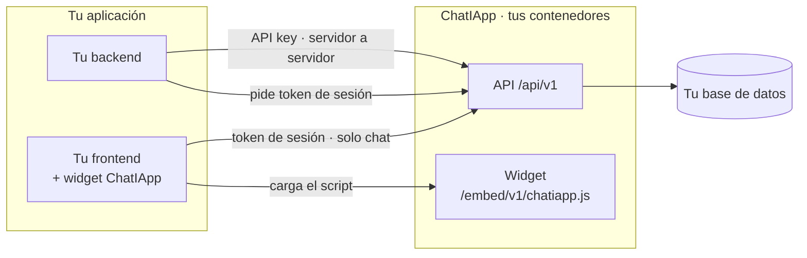
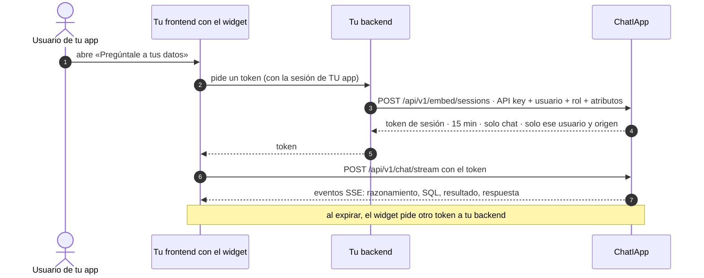

# Integración en tu app

ChatIApp se distribuye como contenedores que corren en **tu** infraestructura. Puedes usar la aplicación completa, o integrarla dentro de tu propio producto: tu backend le hace preguntas por API, o tu frontend muestra el chat embebido, con tu marca y tus usuarios.

> Estado: **diseño**. Este documento es el contrato de la épica de integración (hito M3). Decisión de fondo: [ADR 0007](adr/0007-api-keys-y-tokens-de-sesion.md).

## Tres formas de usarlo

| Modo | Para qué | Quién llama | Credencial |
|---|---|---|---|
| **App completa** | Equipos que quieren el chat listo, con su login | Personas, desde la interfaz de ChatIApp | Usuario y contraseña (JWT) |
| **API sin interfaz** | Tu backend pregunta y recibe SQL, resultados y respuesta para mostrarlos a su manera | Tu servidor | **API key de servidor** |
| **Chat embebido** | El chat de ChatIApp dentro de tu app, con tus colores y tus usuarios | El navegador de tu usuario | **Token de sesión** de 15 minutos que emite tu backend con su API key |



## La regla de oro

**Una API key nunca va en el navegador, en una app móvil ni en un repositorio.** Es una credencial de servidor, como la contraseña de tu base de datos. Para el chat embebido, tu backend cambia la API key por un token de sesión corto, atado a un usuario, un rol, una fuente y un origen.

## API keys

Las crea un administrador desde **Integraciones** en la interfaz o con la línea de comandos del contenedor (útil en despliegues sin interfaz):

```bash
docker compose exec api chatiapp keys create \
  --name "Portal de clientes" \
  --scopes chat,embed \
  --datasource ventas \
  --roles gerente_sucursal \
  --origin https://portal.tuempresa.com
# chia_k7Hx2Lm9_Qp4…   ← se muestra UNA sola vez
```

| Propiedad | Descripción |
|---|---|
| Formato | `chia_<id>_<secreto>`. El prefijo `chia_` permite detectarlas con escáneres de secretos |
| Almacenamiento | Solo el hash (HMAC-SHA256 con una llave del servidor). Si se pierde, se crea otra |
| Alcances | `chat`, `embed`, `sql:preview`, `semantic:read`, `semantic:write`. Ninguna key puede administrar usuarios ni otras keys |
| Fuentes permitidas | Lista de fuentes de datos que puede consultar |
| Roles permitidos | Roles del modelo semántico que tu backend puede asignar a sus usuarios; o un **rol fijo** que se aplica siempre |
| Orígenes permitidos | Dominios desde los que el chat embebido puede usar los tokens de esta key |
| Límites | Peticiones por minuto y presupuesto mensual de IA propios de la key |
| Vida | Fecha de expiración opcional; revocación inmediata; rotación con dos keys activas a la vez |
| Trazabilidad | Último uso, IP y consumo por key; cada turno auditado con la key y el usuario final |

## Identidad del usuario final

Una API key identifica a **tu aplicación**, no a la persona que pregunta. Como los filtros por rol dependen de quién pregunta, cada llamada indica en nombre de quién se hace:

```json
"user": {
  "id": "u-123",
  "role": "gerente_sucursal",
  "attributes": { "sucursales": [1, 2] }
}
```

- ChatIApp **confía en tu backend** para decir quién es el usuario: por eso la key es secreta y de servidor.
- Esa confianza tiene **techo**: el rol debe estar en los roles permitidos de la key (o se usa su rol fijo), y deben venir los atributos que exigen los filtros del rol. Si no, la petición se rechaza.
- El `id` del usuario queda en la auditoría junto con la key.

Validación (siempre antes de ejecutar nada):

| Situación | Respuesta |
|---|---|
| Falta `user` | **422** `end_user_required` |
| La key no incluye la fuente | **403** `datasource_not_allowed` |
| La key tiene un único rol permitido (**rol fijo**) | Se usa ese y se ignora el enviado |
| Falta `user.role` y la key tiene varios roles | **422** `role_required` |
| El rol no está en los roles permitidos de la key (una lista vacía no permite ninguno) | **403** `role_not_allowed` |
| Falta un atributo de los filtros del rol | **422** `missing_attributes` |
| Un atributo tiene otro tipo (`IN ({user.x})` exige una lista; el resto, un valor simple) | **422** `invalid_attributes` |

Las conversaciones quedan ligadas a la key y al `user.id`: otra key u otro usuario final recibe **404** al pedirlas. Solo se pasan al filtro los atributos que el rol usa.

## API sin interfaz

### Con streaming (SSE)

```bash
curl -N https://chatiapp.tuempresa.com/api/v1/chat/stream \
  -H "Authorization: Bearer $CHATIAPP_API_KEY" \
  -H "Content-Type: application/json" \
  -d '{
        "datasource": "ventas",
        "message": "¿Cuánto vendí?",
        "user": { "id": "u-123", "role": "gerente_sucursal", "attributes": { "sucursales": [1, 2] } }
      }'
```

Los eventos son los mismos que usa la interfaz: [FLUJO_CONVERSACIONAL.md](FLUJO_CONVERSACIONAL.md#eventos-de-streaming).

### Sin streaming

Para integraciones simples, `POST /api/v1/chat` devuelve el turno completo en un JSON. Si falta un dato, la respuesta lo dice y tu app responde en la misma conversación:

```json
{
  "conversation_id": "7d0c…",
  "status": "needs_clarification",
  "reasoning": "Es la métrica ventas_netas. No mencionan período.",
  "clarification": {
    "question": "¿De qué período quieres ver las ventas?",
    "options": ["Hoy", "Esta semana", "Este mes", "Mes pasado", "Este año", "Últimos 30 días"],
    "slot": "period"
  }
}
```

```json
{
  "conversation_id": "7d0c…",
  "status": "answered",
  "period": { "start": "2026-11-01", "end_exclusive": "2026-12-01", "label": "Noviembre 2026 (al día 25)" },
  "sql": { "sql": "SELECT SUM(total_ventas) AS ventas_netas FROM ventas_diarias WHERE …", "dialect": "postgres", "origin": "catalog", "summary_table": "ventas_diarias", "filters_applied": ["ventas_diarias: sucursal_id IN (1, 2)"], "metric": "ventas_netas" },
  "result": { "columns": ["ventas_netas"], "rows": [["482315000.00"]], "truncated": false },
  "answer": "Este mes llevas $482,3 M en ventas netas.",
  "usage": { "tokens_in": 1830, "tokens_out": 142, "cost_usd": 0.0031 }
}
```

`sql.metric` (opcional) es el nombre de la métrica del plan cuando el SQL sale del catálogo; no aparece en SQL libre. Úsalo para buscar la etiqueta legible de la métrica, porque la columna del resultado puede llevar un alias técnico como `valor`.

Si tu app prefiere ejecutar el SQL por su cuenta, usa una fuente en **modo solo SQL** (`execute: false`): recibes la consulta validada y con el filtro del rol, sin que ChatIApp toque la base.

### SDKs

Clientes oficiales (`pip install chatiapp` · `npm install @chatiapp/client`; código en [`sdks/`](../sdks/README.md)). Los modelos se generan desde la especificación OpenAPI y el chat, el streaming y los eventos SSE tipados están escritos a mano. El CI falla si los modelos quedan desactualizados respecto a `docs/openapi/v1.json`.

```python
from chatiapp import ChatIApp, EndUser

client = ChatIApp(base_url="https://chatiapp.tuempresa.com", api_key=os.environ["CHATIAPP_API_KEY"])
user = EndUser(id="u-123", role="gerente_sucursal", attributes={"sucursales": [1, 2]})

turn = client.chat("¿Cuánto vendí?", datasource="ventas", user=user)
if turn.needs_clarification:
    turn = client.chat("Este mes", conversation_id=turn.conversation_id, user=user)
print(turn.answer, turn.sql.sql)
```

```ts
import { ChatIApp } from "@chatiapp/client";

const client = new ChatIApp({ baseUrl: "https://chatiapp.tuempresa.com", apiKey: process.env.CHATIAPP_API_KEY! });
for await (const event of client.chatStream({ datasource: "ventas", message: "¿Cuánto vendí este mes?", user })) {
  if (event.type === "answer.delta") process.stdout.write(event.data.text);
}
```

- `chat()` devuelve el turno con `status` (`answered`, `needs_clarification`, `rejected`, `error`); en la respuesta de una aclaración, el SDK recuerda la fuente de la `conversation_id` y no hace falta repetirla.
- Los errores HTTP lanzan `ChatIAppError` (`code`, `message`, estado HTTP). En el stream, un fallo del turno llega como evento `error`.
- Los eventos de `chat_stream`/`chatStream` están tipados (`turn.started`, `step`, `sql`, `answer.delta`…); un evento que el SDK no conoce llega como `UnknownEvent` en Python y se omite en TypeScript.
- Tokens de sesión del chat embebido, desde tu backend: `client.create_embed_session(datasource=…, origin=…, user=…)` (Python) o `client.createEmbedSession({ datasource, origin, user })` (TypeScript); devuelve `token` y `expires_at` para pasar el token al widget.

## Chat embebido

### Cómo se obtiene el token



En tu backend (ejemplo con FastAPI; es igual en cualquier lenguaje):

```python
@app.post("/chatiapp-token")
def chatiapp_token(session = Depends(current_session)):
    r = httpx.post(
        f"{CHATIAPP_URL}/api/v1/embed/sessions",
        headers={"Authorization": f"Bearer {CHATIAPP_API_KEY}"},
        json={
            "datasource": "ventas",
            "origin": "https://portal.tuempresa.com",
            "user": {"id": session.user_id, "role": "gerente_sucursal",
                     "attributes": {"sucursales": session.branch_ids}},
        },
    )
    return {"token": r.json()["token"]}
```

### En tu página

```html
<script src="https://chatiapp.tuempresa.com/embed/v1/chatiapp.js" defer></script>

<chatiapp-chat
  base-url="https://chatiapp.tuempresa.com"
  lang="es"
  theme="auto"
  show-sql="true">
</chatiapp-chat>

<script>
  document.querySelector("chatiapp-chat").getToken = async () => {
    const r = await fetch("/chatiapp-token", { method: "POST", credentials: "include" });
    return (await r.json()).token;
  };
</script>
```

O en React:

```tsx
import { ChatIAppChat } from "@chatiapp/react";

<ChatIAppChat baseUrl="https://chatiapp.tuempresa.com" getToken={fetchChatiappToken} lang="es" />
```

| Opción | Valores | Para qué |
|---|---|---|
| `lang` | `es`, `en` | Idioma de la interfaz y de las respuestas |
| `theme` | `auto`, `light`, `dark` o variables CSS (`--chatiapp-accent`, `--chatiapp-radius`, `--chatiapp-font`) | Que se vea como tu app |
| `show-sql` / `show-reasoning` | `true`, `false` | Ocultar el detalle técnico a usuarios de negocio (sigue en la auditoría) |
| `suggested-questions` | lista | Preguntas iniciales propias |
| Eventos DOM | `chatiapp:answer`, `chatiapp:clarification`, `chatiapp:error` | Reaccionar desde tu app (analítica, navegación) |

**Detalle de cada opción**

- `suggested-questions` acepta una lista JSON (`suggested-questions='["¿Ventas de hoy?"]'`) o textos separados por `|`; desde JavaScript, la propiedad `suggestedQuestions` (arreglo).
- `theme="auto"` sigue la preferencia del sistema. Variables CSS (se definen en la página, sobre `chatiapp-chat` o un ancestro): `--chatiapp-accent`, `--chatiapp-radius`, `--chatiapp-font`, y además `--chatiapp-background`, `--chatiapp-foreground`, `--chatiapp-card`, `--chatiapp-muted`, `--chatiapp-muted-foreground`, `--chatiapp-border`. El alto lo fija tu CSS sobre `chatiapp-chat` (mínimo 24 rem).
- `getToken()` devuelve el token de `POST /embed/sessions` (cadena o promesa). El widget lo guarda hasta 30 s antes de que expire y, si el servidor responde 401, vuelve a llamarlo y repite la petición **una vez**; la conversación sigue (mismo `conversation_id`). Si `getToken` falla, emite `chatiapp:error` con `code: "token_error"`.
- Los eventos son `CustomEvent` que burbujean (`bubbles`, `composed`) desde `<chatiapp-chat>`; su `detail`:

| Evento | `detail` |
|---|---|
| `chatiapp:answer` | `{ text, conversationId, sql, columns, rows }` (`sql` es `null` si no hubo consulta) |
| `chatiapp:clarification` | `{ question, options, conversationId }` |
| `chatiapp:error` | `{ code, message, recoverable }` |

`show-sql="false"` y `show-reasoning="false"` solo ocultan el detalle en el widget; el servidor lo sigue enviando y auditando.

**Qué se descarga.** `/embed/v1/chatiapp.js` es un cargador de unos 200 bytes que importa `chatiapp-widget.js` desde la misma carpeta (`/embed/v1/`); los gráficos y el formato del SQL son partes que solo se descargan cuando una respuesta las usa. Lo que se descarga al cargar la página pesa menos de 150 KB comprimido (`pnpm run build` en `embed/` lo verifica). Esos archivos son públicos y se sirven con `Access-Control-Allow-Origin: *` (`import()` entre orígenes exige CORS); no contienen datos.

**React.** `@chatiapp/react` (carpeta `embed/react/`) envuelve el mismo elemento: `baseUrl`, `getToken`, `lang`, `theme`, `showSql`, `showReasoning`, `suggestedQuestions`, `onAnswer`, `onClarification`, `onError`, `className` y `style` (las variables `--chatiapp-*` van en `style`). `react` y `react-dom` (≥ 19) son dependencias peer.

El widget vive en un **Shadow DOM**: no hereda ni altera los estilos de tu página y no lee nada de ella. Los textos propios del widget (título, sugerencias, enviar, cancelar) siguen `lang`; los de los bloques compartidos con la interfaz (razonamiento, SQL, resultados) están por ahora solo en español.

### Qué puede hacer un token de sesión

| Puede | No puede |
|---|---|
| Preguntar en la fuente indicada, con el rol y atributos que fijó tu backend | Cambiar de fuente, de rol o de atributos |
| Leer y continuar **sus** conversaciones | Ver conversaciones de otros usuarios |
| Usarse desde el origen indicado | Usarse desde otro dominio (CORS y verificación de `Origin`) |
| Vivir 15 minutos (configurable, máximo 60) | Renovarse solo: se pide otro a tu backend |

Revocar la API key invalida al instante todos sus tokens.

## Desplegar junto a tu app

Una sola imagen, `ghcr.io/jmmana/chatiapp`, trae la API, el motor, el agente, la interfaz completa y el script del widget ([ADR 0008](adr/0008-imagen-unica-con-sqlite.md)). Si solo integras por API o widget, la interfaz sigue ahí para administrar fuentes, proveedores y API keys. Un fragmento para tu `docker-compose.yml`:

```yaml
services:
  chatiapp:
    image: ghcr.io/jmmana/chatiapp:1
    environment:
      CHATIAPP_SECRET_KEY: ${CHATIAPP_SECRET_KEY}
      CHATIAPP_CONFIG: /config/chatiapp.yaml
      ANTHROPIC_API_KEY: ${ANTHROPIC_API_KEY}
      VENTAS_DB_URL: ${VENTAS_DB_URL}
    volumes:
      - chatiapp:/data              # base SQLite de la app
      - ./chatiapp:/config:ro       # chatiapp.yaml + semantic-model.yaml
    ports: ["8090:8080"]

volumes:
  chatiapp:
```

La base de la app es SQLite en `/data`, suficiente para una réplica. Con varias réplicas, apunta `CHATIAPP_DATABASE_URL` a PostgreSQL (`postgresql+psycopg://…`).

### Kubernetes con Helm

El chart en [`deploy/helm/chatiapp`](../deploy/helm/chatiapp) despliega la imagen única, publica la API mediante un Service y puede crear un Ingress. Crea antes un Secret en el namespace de destino; no guardes credenciales en `values.yaml` ni en el repositorio. El archivo, protegido fuera del repositorio, contiene una línea por variable, por ejemplo `CHATIAPP_SECRET_KEY`, `ANTHROPIC_API_KEY` y `VENTAS_DB_URL`:

```bash
kubectl create namespace analytics
kubectl -n analytics create secret generic chatiapp-secrets \
  --from-env-file=/ruta/segura/chatiapp.env
```

La configuración y el modelo semántico de ejemplo se incluyen en el ConfigMap del chart. Para usar los tuyos, pasa ambos archivos como valores de texto (sin credenciales):

```bash
helm upgrade --install chatiapp ./deploy/helm/chatiapp \
  --namespace analytics \
  --set existingSecret=chatiapp-secrets \
  --set app.publicUrl=https://chat.tuempresa.com \
  --set ingress.enabled=true \
  --set ingress.className=nginx \
  --set 'ingress.hosts[0].host=chat.tuempresa.com' \
  --set-file configuration.chatiappYaml=/ruta/config/chatiapp.yaml \
  --set-file configuration.semanticModelYaml=/ruta/config/semantic-model.yaml
```

El modelo se monta como `/config/ventas/semantic-model.yaml`; en `chatiapp.yaml`, usa `semantic_model: ./ventas/semantic-model.yaml`. El Secret debe incluir `CHATIAPP_SECRET_KEY`, y su valor debe ser estable entre reinicios y compartido por todas las réplicas. Para PostgreSQL también debe contener `CHATIAPP_DATABASE_URL` con una URL `postgresql+psycopg://…`. SQLite usa un PVC persistente en `/data` y exige una réplica. Para escalar, configura `database.type=postgresql` y `replicaCount` mayor que uno; el chart no crea una base PostgreSQL, así que apunta a una instancia externa. Las actualizaciones de SQLite usan estrategia `Recreate` para evitar que dos pods abran simultáneamente el mismo volumen.

El Ingress incluye, por defecto, anotaciones de NGINX para desactivar el buffering y permitir tiempos de espera largos para SSE. Adáptalas si usas otro controlador.

## Versionado de la API

- Todo vive bajo `/api/v1`. La especificación OpenAPI se publica en `/api/v1/openapi.json` y se versiona en el repositorio.
- Antes de **v1.0.0** el contrato puede cambiar; cada cambio se anuncia en el `CHANGELOG`.
- Desde v1.0.0, un cambio incompatible solo llega en `/api/v2`. Lo que se vaya a retirar se anuncia con las cabeceras `Deprecation` y `Sunset` con al menos 6 meses de aviso.
- CI compara la especificación con la de `main` y falla ante un cambio incompatible no anunciado.

## Seguridad de la integración

| Riesgo | Mitigación |
|---|---|
| API key expuesta en el navegador o en un repositorio | El widget nunca usa keys; prefijo `chia_` detectable por escáneres de secretos; revocación y rotación inmediatas |
| Tu backend asigna un rol que no debería | Roles permitidos o rol fijo por key; atributos obligatorios validados; auditoría con el usuario final |
| Token de sesión robado | Vida corta, atado a un usuario, una fuente y un origen; solo alcance de chat; revocable con la key |
| Otro sitio embebe tu chat | CORS y verificación de `Origin` contra los orígenes permitidos de la key |
| CSRF | Los tokens van en la cabecera `Authorization`, no en cookies |
| Abuso de costo desde una integración | Límites y presupuesto por key, además de los del usuario |

Modelo de amenazas general: [SEGURIDAD.md](SEGURIDAD.md#modelo-de-amenazas).

## Más adelante

- **Servidor MCP**, para que otros agentes de IA (asistentes de escritorio, copilotos internos) consulten ChatIApp como una herramienta, con los mismos permisos de una API key.
- **Inicio de sesión federado** (OIDC/SAML) para la app completa.
