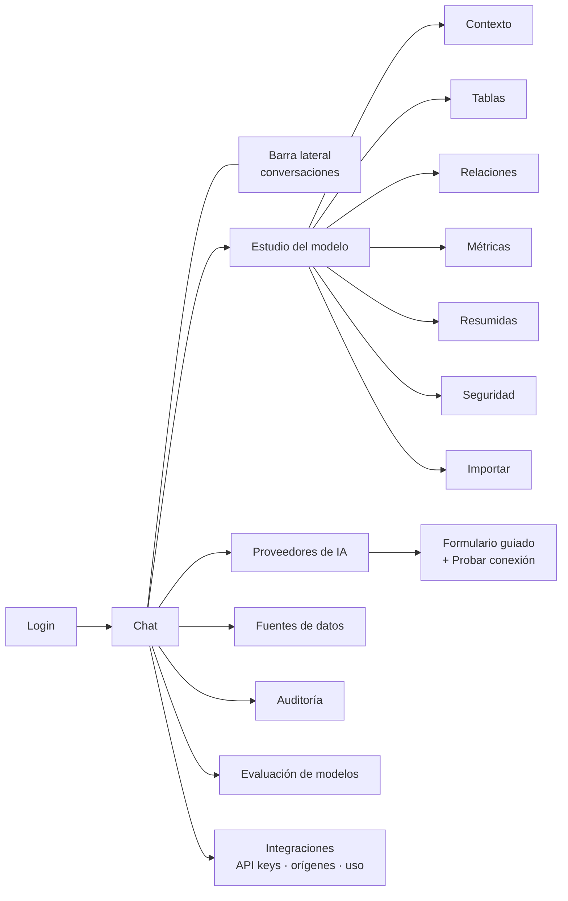

# Interfaz

La interfaz tiene que transmitir **confianza**: que el número es correcto, que se puede verificar y que nada se tocó sin permiso. Por eso el razonamiento, el período y el SQL están siempre a un clic, sin estorbar a quien solo quiere el dato.

## Principios de diseño

| Principio | Cómo se ve |
|---|---|
| **El dato primero** | La respuesta abre con una tarjeta grande con el número y su período; el detalle va debajo |
| **El trabajo a la vista, no en la cara** | Razonamiento y SQL plegables: abiertos mientras se generan, plegados al terminar |
| **Calma y densidad** | Paleta neutra (slate), un único acento (índigo → cian, solo para marca y foco), mucho aire entre bloques, tipografía Inter y JetBrains Mono, cifras tabulares |
| **Cada estado tiene diseño** | Vacío, cargando, aclaración, rechazo, error de base, respaldo de proveedor, modo solo SQL |
| **Hecho para el idioma** | Números y monedas con `Intl` según el `locale` del modelo (`$ 482,3 M` en es-CO), fechas en español o inglés |
| **Claro y oscuro** | Ambos temas de primera clase, siguiendo la preferencia del sistema |

Stack: React 19, TypeScript, Vite, Tailwind CSS, [shadcn/ui](https://ui.shadcn.com/), TanStack Query, Recharts, lucide-react.

## Mapa de pantallas



## Chat

```text
┌───────────────────┬──────────────────────────────────────────────────────────┐
│ ◆ ChatIApp        │ Ventas (demo) ▾    claude-sonnet-5-5 ▾    Rol: Gerente ▾ │
│                   ├──────────────────────────────────────────────────────────┤
│ + Nueva pregunta  │                                       ┌────────────────┐ │
│                   │                                       │ ¿Cuánto vendí? │ │
│ HOY               │                                       └────────────────┘ │
│ ● Ventas de nov.  │ ● ┌ Razonamiento ───────────────────────────────── ▾ ┐   │
│   Top productos   │   │ ✓ Métrica: Ventas netas (facturas.total, PAGADA) │   │
│ AYER              │   │ ! Falta el período                               │   │
│   Clientes nuevos │   └──────────────────────────────────────────────────┘   │
│                   │   ¿De qué período quieres ver las ventas?                │
│ ───────────────── │   [Hoy] [Esta semana] [Este mes] [Mes pasado] [Este año] │
│ Chat              │                                           ┌──────────┐   │
│ Modelo semántico  │                                           │ Este mes │   │
│ Proveedores de IA │                                           └──────────┘   │
│ Fuentes de datos  │ ● ✓ 1 – 25 nov 2026   ✓ ventas_diarias   ✓ SQL validado  │
│ Auditoría         │   ┌ VENTAS NETAS · NOVIEMBRE 2026 (AL DÍA 25) ───────┐   │
│ Evaluación        │   │ $ 482,3 M                 ▲ 12,4 % vs. octubre   │   │
│                   │   └──────────────────────────────────────────────────┘   │
│                   │   ▸ SQL · SQLite   [solo lectura] [filtro de rol] Copiar │
│                   │   Este mes llevas $482,3 M en ventas netas, 12,4 % más…  │
│                   │   0,8 s · 1 240 tokens · US$ 0,004                       │
│                   ├──────────────────────────────────────────────────────────┤
│                   │ ┌──────────────────────────────────────────────────────┐ │
│ Juan · Admin      │ │ Pregunta sobre tus datos…                     Enviar │ │
│                   │ └──────────────────────────────────────────────────────┘ │
└───────────────────┴──────────────────────────────────────────────────────────┘
```

- **Barra superior:** fuente de datos, modelo de IA de la conversación y, para administradores, «Rol» para probar cómo ve los datos otro rol.
- **Razonamiento:** cada paso aparece en vivo con su estado (en curso, listo, advertencia). Se pliega al terminar y deja un resumen de una línea.
- **Aclaración:** opciones como botones navegables con teclado; también se puede escribir.
- **Resultado:** valor único → tarjeta KPI; serie de tiempo → línea; categorías → barras; resto → tabla. Siempre se puede cambiar de vista y exportar a CSV.
- **SQL:** formateado y resaltado, con insignias de dialecto, tabla resumida, filtro de rol y «solo lectura». Botón copiar.
- **Pie de la respuesta:** duración, tokens y costo.

## Estudio del modelo

```text
┌──────────────────────────────────────────────────────────────────────────────┐
│ Modelo semántico · Ventas (demo)                 v12 · guardado   [Publicar] │
│ Contexto  [Tablas]  Relaciones  Métricas  Resumidas  Seguridad  Importar     │
├─────────────────────────┬────────────────────────────────────────────────────┤
│ Buscar tabla…           │ facturas                                           │
│                         │ Encabezado de cada factura de venta. Una fila por  │
│ ▸ clientes        7 col │ factura.                                           │
│ ● facturas       11 col │ Sinónimos: ventas · facturación · comprobantes     │
│ ▸ factura_detalle 6 col │ ────────────────────────────────────────────────── │
│ ▸ productos       6 col │ Columna     Rol        Descripción          Oculta │
│ ▸ sucursales      5 col │ fecha       Tiempo     Fecha de emisión…     [ ]   │
│ ▸ ventas_diarias  6 col │ subtotal    Medida     Valor antes de IVA…   [ ]   │
│ ▸ ventas_mensuales      │ total       Medida     Valor final cobrado…  [ ]   │
│                         │ estado      Dimensión  Solo PAGADA cuenta…   [ ]   │
│ 3 columnas sin          │ canal       Dimensión  (vacío)               [ ]   │
│ descripción             │                                                    │
│ [Sugerir con IA]        │ [+ Columna]                                        │
└─────────────────────────┴────────────────────────────────────────────────────┘
```

- **Sugerir con IA** propone descripciones, sinónimos y roles para lo que está vacío; cada sugerencia se acepta o descarta, nunca se aplica sola.
- **Métricas** tiene un panel **Probar**: eliges métrica, período y dimensiones y ves el SQL que generaría el motor (y qué tabla resumida usaría), sin gastar tokens.
- **Seguridad** tiene **Ver como**: eliges un rol y atributos de usuario y ves el SQL con el filtro inyectado.
- Cada **Publicar** crea una versión nueva; el historial permite comparar y volver atrás.

## Importar

```text
┌──────────────────────────────────────────────────────────────────────────────┐
│ Importar estructura                                                          │
│ ┌──────────────────────────────────────────────────────────────────────────┐ │
│ │       Arrastra un archivo .sql, .csv, .xlsx, .yaml o .json               │ │
│ │                 o  [Leer desde la base conectada]                        │ │
│ └──────────────────────────────────────────────────────────────────────────┘ │
│                                                                              │
│ Vista previa · diccionario.xlsx                                              │
│ + 2 tablas nuevas      ventas_diarias, ventas_mensuales                      │
│ ~ 4 columnas cambian   facturas.total: numeric(12,2) → numeric(14,2)  …      │
│ ~ 9 descripciones      se completan las vacías; las tuyas se conservan       │
│ − 1 no encontrada      clientes.telefono (se marca, no se borra)             │
│                                                       [Cancelar] [Aplicar]   │
└──────────────────────────────────────────────────────────────────────────────┘
```

## Proveedores de IA

```text
┌──────────────────────────────────────────────────────────────────────────────┐
│ Proveedores de IA                                          [+ Agregar]       │
│                                                                              │
│ CONFIGURADOS                                                                 │
│ ┌───────────────────────┐ ┌───────────────────────┐ ┌───────────────────────┐│
│ │ ★ Claude              │ │ DeepSeek              │ │ Ollama (local)        ││
│ │ claude-sonnet-5-5     │ │ deepseek-chat         │ │ qwen2.5:14b           ││
│ │ ● Conectado · 840 ms  │ │ ● Conectado · 1,2 s   │ │ ● Conectado · 2,1 s   ││
│ │ planner · sql         │ │ answer · respaldo     │ │ suggest               ││
│ └───────────────────────┘ └───────────────────────┘ └───────────────────────┘│
│                                                                              │
│ AGREGAR                                                                      │
│ API directa     Claude · ChatGPT · Gemini · Mistral · Grok · Groq            │
│ Plataformas     Bedrock · Azure · Vertex AI · OpenRouter · GitHub Models     │
│ Modelos chinos  DeepSeek · Qwen · Kimi · GLM · MiniMax · Doubao              │
│ Local           Ollama · vLLM · LM Studio · Compatible con OpenAI            │
└──────────────────────────────────────────────────────────────────────────────┘
```

Al elegir un proveedor se abre un panel lateral con el **formulario generado desde el catálogo** (cada proveedor declara sus campos): credenciales, región o endpoint, modelo (con lista en vivo cuando la API lo permite), parámetros y tareas asignadas. **Probar conexión** funciona antes de guardar. Los secretos nunca vuelven a mostrarse: solo su máscara y un botón «Reemplazar».

## Estados

| Estado | Qué ve el usuario |
|---|---|
| Conversación vacía | Preguntas sugeridas generadas desde el catálogo de métricas («¿Cuánto vendí este mes?», «Ventas por sucursal del mes pasado») |
| Generando | Pasos en vivo; el compositor permite cancelar |
| Aclaración | Pregunta con botones; el resto de la interfaz sigue disponible |
| SQL rechazado | Motivo en lenguaje claro («La consulta intentaba leer `clientes.email`, que está oculta») y el SQL rechazado plegado para quien quiera verlo |
| Error de la base | Mensaje del motor resumido, el SQL y la opción de reintentar |
| Respaldo de proveedor | Aviso discreto: «Claude no respondió; usé DeepSeek» |
| Modo solo SQL | El SQL validado con botón copiar y una nota: «Esta fuente no ejecuta consultas» |
| Resultado recortado | «Mostrando 1 000 de más filas; exporta o filtra para ver el resto» |

## Accesibilidad

- WCAG 2.2 nivel AA: contraste, foco visible, objetivos táctiles de 24 px o más.
- Los pasos en vivo se anuncian con `aria-live="polite"`; la respuesta final con un solo anuncio, no token a token.
- Todo con teclado: `Enter` envía, `Shift+Enter` salto de línea, `Ctrl/⌘+K` nueva conversación, flechas entre opciones de aclaración, `Esc` cancela la generación.
- Respeta `prefers-reduced-motion`.
- Las gráficas tienen tabla equivalente y no dependen solo del color.
