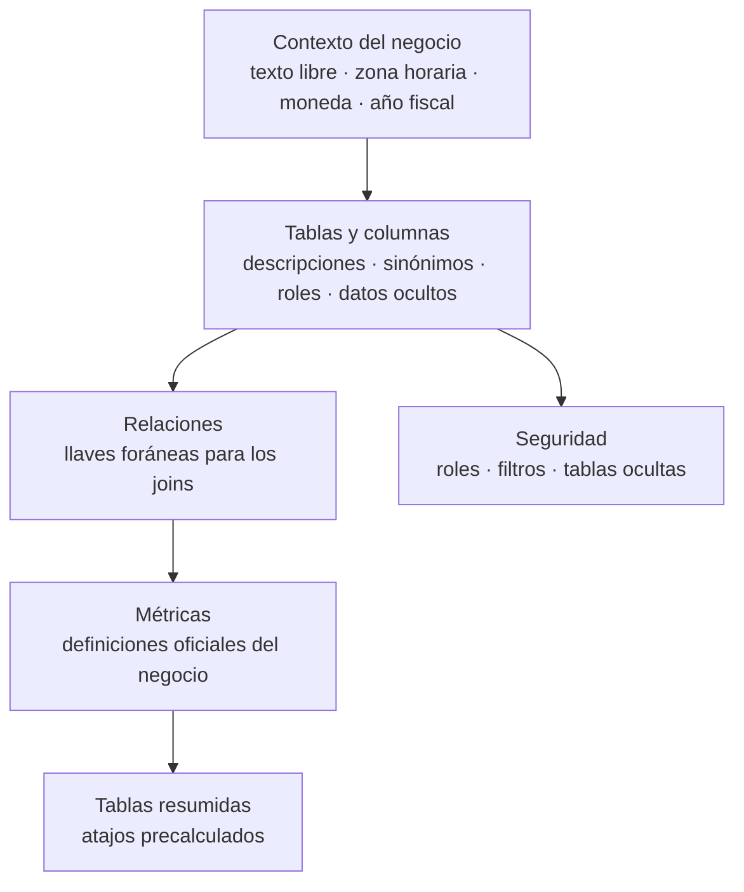

# Modelo semántico

El modelo semántico es **todo lo que ChatIApp sabe de tu base de datos**: qué significa cada tabla y columna, cómo se relacionan, cómo se calculan tus métricas, qué tablas resumidas existen y qué puede ver cada rol. La calidad de las respuestas depende más de este modelo que del proveedor de IA.

Ejemplo completo y válido: [`examples/ventas/semantic-model.yaml`](../examples/ventas/semantic-model.yaml).

## Capas



## Importar la estructura

En el **Estudio del modelo** puedes combinar varias fuentes. Ninguna importación se aplica sin una vista previa.

| Formato | Qué lee | Ideal para |
|---|---|---|
| **DDL** (`.sql`) | `CREATE TABLE` con tipos, llaves primarias, llaves foráneas y `UNIQUE`; `COMMENT ON TABLE/COLUMN` (PostgreSQL, Oracle) y `COMMENT '…'` en línea (MySQL) como descripciones | Tienes el script de creación de la base |
| **Diccionario de datos** (`.csv`, `.xlsx`) | Una fila por columna con descripción, sinónimos, rol, si está oculta y valores de ejemplo | El negocio ya documentó la base en Excel |
| **Modelo** (`.yaml`, `.json`) | El modelo completo, incluidas métricas, resumidas y seguridad | Versionar el modelo en Git junto al código |
| **Base conectada** | Esquemas, tablas, columnas, llaves y comentarios vía el inspector de SQLAlchemy. Valores de muestra opcionales, si el nivel de privacidad lo permite | Partir de cero con una base existente |

El DDL de la demo ([`examples/ventas/schema.sql`](../examples/ventas/schema.sql)) se verificó con sqlglot 30.35: se leen sus 7 `CREATE TABLE` y sus 11 `COMMENT ON`.

### Formato del diccionario (CSV o XLSX)

Encabezados en español o en inglés. Las listas se separan con `|`. Una fila con la columna vacía describe la **tabla**.

| Columna | Inglés | Obligatoria | Valores |
|---|---|---|---|
| `tabla` | `table` | sí | Nombre de la tabla, con esquema si aplica (`ventas.facturas`) |
| `columna` | `column` | no | Vacía = la fila describe la tabla |
| `tipo` | `type` | no | Tipo SQL (`numeric(14,2)`) |
| `descripcion` | `description` | no | Texto libre |
| `sinonimos` | `synonyms` | no | `ventas sin IVA\|base gravable` |
| `rol` | `role` | no | `time`, `measure`, `dimension`, `id`, `other` |
| `oculta` | `hidden` | no | `si`, `no`, `true`, `false`, `1`, `0` |
| `valores_ejemplo` | `sample_values` | no | `PAGADA\|PENDIENTE\|ANULADA` |

Ejemplo: [`examples/ventas/diccionario.csv`](../examples/ventas/diccionario.csv).

### Fusión con lo que ya existe

Importar nunca destruye trabajo hecho a mano:

| Caso | Qué pasa |
|---|---|
| Tabla o columna nueva | Se agrega |
| Tipo cambiado | Se actualiza y se marca en la vista previa |
| Descripción vacía en el modelo, presente en la fuente | Se completa |
| Descripción escrita a mano en el modelo | **Se conserva**; la de la fuente aparece como sugerencia |
| Columna que ya no está en la fuente | Se marca «no encontrada»; no se borra sola |

La vista previa muestra `+ nuevas`, `~ cambiadas` y `− no encontradas` antes de aplicar.

## Contexto del negocio

```yaml
business_context: |
  «Vender» significa facturas en estado PAGADA. Las ANULADAS nunca cuentan.
  `total` incluye IVA; `subtotal` es sin IVA.
settings:
  timezone: America/Bogota
  currency: COP
  locale: es-CO
  fiscal_year_start_month: 1
  week_starts_on: monday
  default_row_limit: 1000
```

`business_context` va en cada pregunta que se le hace a la IA. Escríbelo como se lo explicarías a un analista nuevo en su primer día.

## Tablas y columnas

| Campo | Descripción |
|---|---|
| `name` | Nombre real, con esquema si aplica |
| `description` | Qué representa **una fila** |
| `synonyms` | Cómo la llama la gente |
| `primary_key` | Columnas de la llave primaria |
| `time_column` | Columna de tiempo por defecto de la tabla |
| `columns[].role` | `time` (fechas), `measure` (se suma o promedia), `dimension` (se agrupa o filtra), `id` (llaves), `other` |
| `columns[].hidden` | Dato sensible: **no existe** para la IA ni para el guardián (cualquier SQL que la use se rechaza) |
| `columns[].sample_values` | Valores reales de ejemplo; ayudan a filtrar («ventas en línea» → `canal = 'ONLINE'`) |

## Relaciones

```yaml
relationships:
  - { from: facturas.sucursal_id, to: sucursales.id }
  - { from: factura_detalle.factura_id, to: facturas.id }
```

El motor busca el camino más corto entre la tabla de la métrica y la de cada dimensión. Si hay dos caminos posibles del mismo largo, el modelo no valida: hay que desambiguar.

## Métricas

Una métrica es una **definición oficial** del negocio. Cuando una pregunta coincide con una métrica, el SQL lo arma el motor, siempre igual, sin depender de la interpretación de la IA.

| Campo | Obligatorio | Descripción |
|---|---|---|
| `name` | sí | Identificador (`ventas_netas`) |
| `label` | sí | Nombre visible (`Ventas netas`) |
| `description` | no | Qué mide y qué excluye |
| `synonyms` | no | Cómo la pide la gente (`cuánto vendí`, `facturación`) |
| `table` | sí | Tabla base |
| `expression` | sí | Expresión SQL agregada en el dialecto del modelo (`SUM(total)`) |
| `time_column` | sí | Columna para el período; puede estar en otra tabla (`facturas.fecha`) |
| `filters` | no | Condiciones que **siempre** aplican (`estado = 'PAGADA'`) |
| `dimensions` | no | Por qué se puede desglosar (`tabla.columna`) |
| `format` | no | `currency`, `integer`, `number`, `percent` |
| `requires_period` | no | `true` (por defecto): si no hay período, se pregunta |
| `default_period` | no | Período que se asume tras 2 aclaraciones sin respuesta |
| `additive` | no | `false` para promedios, razones y conteos distintos; condiciona el uso de resumidas |

## Tablas resumidas

Tablas precalculadas (diarias, mensuales…) que responden más rápido. El motor decide **solo** cuándo usarlas, con reglas fijas.

| Campo | Descripción |
|---|---|
| `table` | Tabla resumida (también declarada en `tables`) |
| `grain` | `day`, `week`, `month`, `quarter`, `year` |
| `time_column` | Columna de tiempo de la resumida |
| `includes_current_period` | `false` si se carga al cierre y no tiene el período en curso |
| `metrics` | Métrica del catálogo → expresión sobre la resumida |
| `dimensions` | Dimensión de la métrica → columna de la resumida (las alcanzables por relación no hace falta mapearlas) |

### Reglas de enrutamiento

Una tabla resumida se usa solo si **todas** se cumplen:

1. La métrica está declarada en `metrics` de la resumida.
2. Todas las dimensiones y filtros pedidos están cubiertos: mapeados en `dimensions` o alcanzables por una relación desde la resumida.
3. La granularidad pedida es igual o más gruesa que `grain` (una tabla mensual no da ventas por día).
4. Los límites del período están alineados a `grain` (una tabla mensual no responde «del 3 al 17 de marzo»).
5. Si el período toca el período en curso, la resumida debe tener `includes_current_period: true`.
6. Si la métrica tiene `additive: false`, la resumida debe declarar una expresión correcta para ella (por ejemplo `SUM(total_ventas) / SUM(num_facturas)`, nunca un promedio de promedios).
7. Si el rol del usuario filtra alguna tabla base que lee la consulta, la resumida también debe tener filtro para ese rol; si no, el rol vería filas ajenas. Un rol que no existe no usa resumidas.

Si varias califican, gana la de **granularidad más gruesa** (menos filas que leer). Si ninguna califica, se usan las tablas base. La decisión y su motivo aparecen en el razonamiento.

Con el modelo de la demo:

| Pregunta | Tabla elegida | Por qué |
|---|---|---|
| ¿Cuánto vendí este mes? | `ventas_diarias` | `ventas_mensuales` no incluye el mes en curso (regla 5) |
| Ventas del mes pasado | `ventas_mensuales` | Mes cerrado y alineado; es la más gruesa |
| Ventas de 2025 por mes | `ventas_mensuales` | Granularidad mensual, año cerrado |
| Ventas del 3 al 17 de marzo | `ventas_diarias` | El rango no está alineado a meses (regla 4) |
| Ventas de octubre por canal | `ventas_diarias` | `ventas_mensuales` no tiene canal (regla 2) |
| Unidades por categoría el mes pasado | `factura_detalle` + `productos` | Ninguna resumida tiene producto |
| Clientes activos este año | `facturas` | Conteo distinto, no declarado en las resumidas (regla 6) |

## Seguridad

```yaml
security:
  default_role: gerente_sucursal
  roles:
    - name: gerente_sucursal
      filters:
        - { table: facturas,       condition: "sucursal_id IN ({user.sucursales})" }
        - { table: ventas_diarias, condition: "sucursal_id IN ({user.sucursales})" }
    - name: mercadeo
      hidden_tables: [clientes]
```

- Los filtros se inyectan en **todo** SQL que se ejecute, del catálogo o de la IA, en cada aparición de la tabla (joins, subconsultas, CTE). Cómo: [SEGURIDAD.md](SEGURIDAD.md#filtro-por-rol).
- `{user.x}` toma el atributo `x` del usuario autenticado y se inserta como **literal escapado** (una lista se vuelve `1, 2, 3`).
- **Falla cerrado:** si al usuario le falta un atributo que su rol necesita, la consulta se rechaza; nunca se ejecuta sin filtro.
- Una tabla filtrada en un rol debe filtrarse también en sus tablas resumidas; el validador avisa si falta alguna.

## Validaciones al guardar

El modelo se valida con Pydantic antes de guardarse o al arrancar si viene de archivo:

- Nombres únicos de tablas, columnas, métricas y roles.
- Toda referencia existe: relaciones, `time_column`, dimensiones, tablas de filtros, métricas de las resumidas.
- `expression` y `filters` se parsean con sqlglot en el dialecto del modelo.
- `time_column` apunta a una columna con rol `time`.
- Las condiciones de rol solo usan marcadores `{user.nombre}` bien formados.
- Ninguna métrica, dimensión o filtro usa columnas ocultas.
- Cada dimensión de una métrica es alcanzable por relaciones desde su tabla y por un único camino más corto (si hay dos del mismo largo, no valida).
- Los campos desconocidos se rechazan: un error de tipeo no se ignora en silencio.

Cada error trae la ruta del campo (`metrics[2].dimensions[0]`) y se reportan todos juntos. Una **advertencia** (no un error) avisa si una tabla filtrada en un rol tiene tablas resumidas sin filtro para ese rol.

El esquema vive en `backend/app/semantic/schema.py`. Su JSON Schema, para autocompletar en editores, está en [`schema/semantic-model.schema.json`](schema/semantic-model.schema.json) y se regenera con `uv run python -m app.semantic.schema` desde `backend/`.

## Cómo escribir buenas descripciones

- Describe **qué es una fila**: «Una fila por factura», no «Tabla de facturas».
- Escribe las **trampas**: «`total` incluye IVA», «las anuladas no se borran, cambian de estado».
- Usa las **palabras del negocio** como sinónimos: si en la empresa dicen «tiquetes», agrégalo.
- Da **valores de ejemplo** en columnas de categorías: así «ventas en línea» se traduce a `canal = 'ONLINE'` sin adivinar.
- Si dos columnas se parecen, explica **cuándo usar cada una**.
