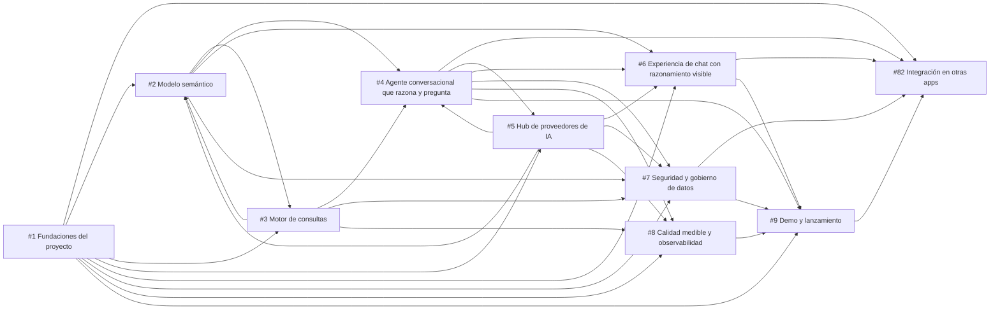

# Roadmap

> Generado desde el backlog publicado en GitHub. La fuente de verdad son los [issues](https://github.com/jmmana/ChatIApp/issues) y el [tablero del proyecto](https://github.com/users/jmmana/projects/2).

Cada tarea tiene objetivo, criterios de aceptación verificables, archivos relevantes, tamaño y dependencias (ver [CONTRIBUTING.md](../CONTRIBUTING.md#cómo-se-escribe-una-tarea)).

## Hitos

| Hito | Qué entrega | Tareas |
|---|---|---|
| [**M0 · Fundaciones**](https://github.com/jmmana/ChatIApp/milestone/1) | Backend y frontend que compilan, CI, Docker Compose, base de datos de la app, configuración validada, cifrado de credenciales y el dataset demo de ventas. | 8 |
| [**M1 · MVP «¿Cuánto vendí?»**](https://github.com/jmmana/ChatIApp/milestone/2) | De punta a punta con un proveedor: modelo semántico (importar y editar), motor de consultas (períodos, catálogo, resumidas, guardián, ejecución), agente que pide aclaraciones y chat con razonamiento visible. Termina con v0.1.0. | 38 |
| [**M2 · Cualquier IA**](https://github.com/jmmana/ChatIApp/milestone/3) | Hub completo de proveedores (API directa, plataformas cloud, modelos chinos y locales), enrutamiento por tarea con respaldo, comparación con el período anterior, entidades y preguntas de seguimiento. | 11 |
| [**M3 · Listo para empresa**](https://github.com/jmmana/ChatIApp/milestone/4) | Login y roles, filtros por rol con atributos del usuario, auditoría, niveles de privacidad hacia la IA, defensa contra inyección de prompt, límites de uso y accesibilidad AA. Además, integración en otras apps: API keys de servidor, chat embebible con tokens de sesión, SDKs y API /api/v1 versionada. | 17 |
| [**M4 · Calidad medible**](https://github.com/jmmana/ChatIApp/milestone/5) | Set de evaluación dorado, comparativa de modelos, observabilidad, pruebas de integración multimotor y lanzamiento de v1.0. | 8 |

## Dependencias entre épicas

## M0 · Fundaciones

Backend y frontend que compilan, CI, Docker Compose, base de datos de la app, configuración validada, cifrado de credenciales y el dataset demo de ventas.

### [#1](https://github.com/jmmana/ChatIApp/issues/1) Fundaciones del proyecto

| # | Tarea | Prioridad | Tamaño | Depende de |
|---|---|---|---|---|
| [#10](https://github.com/jmmana/ChatIApp/issues/10) | Backend · Esqueleto FastAPI con health check, uv, ruff, mypy y pytest | p0 | S | — |
| [#11](https://github.com/jmmana/ChatIApp/issues/11) | Frontend · Esqueleto React + Vite + TypeScript + Tailwind + shadcn/ui con el layout de la app | p0 | M | — |
| [#12](https://github.com/jmmana/ChatIApp/issues/12) | Backend · Base de datos de la app con SQLAlchemy 2 y migraciones Alembic | p0 | M | [#10](https://github.com/jmmana/ChatIApp/issues/10) |
| [#13](https://github.com/jmmana/ChatIApp/issues/13) | Backend · Configuración por entorno y chatiapp.yaml validados con Pydantic al arrancar | p0 | M | [#12](https://github.com/jmmana/ChatIApp/issues/12) |
| [#14](https://github.com/jmmana/ChatIApp/issues/14) | Seguridad · Cifrado de credenciales con Fernet, rotación de llave y enmascarado | p0 | S | [#13](https://github.com/jmmana/ChatIApp/issues/13) |
| [#15](https://github.com/jmmana/ChatIApp/issues/15) | Infra · Docker Compose con api, web (nginx), app-db y Ollama opcional | p1 | M | [#11](https://github.com/jmmana/ChatIApp/issues/11) [#12](https://github.com/jmmana/ChatIApp/issues/12) |
| [#16](https://github.com/jmmana/ChatIApp/issues/16) | Infra · CI en GitHub Actions con lint, tipos, pruebas y build | p0 | S | [#10](https://github.com/jmmana/ChatIApp/issues/10) [#11](https://github.com/jmmana/ChatIApp/issues/11) |
| [#17](https://github.com/jmmana/ChatIApp/issues/17) | Datos · Dataset de demostración «Ventas» con generador reproducible en SQLite | p0 | M | [#10](https://github.com/jmmana/ChatIApp/issues/10) |

## M1 · MVP «¿Cuánto vendí?»

De punta a punta con un proveedor: modelo semántico (importar y editar), motor de consultas (períodos, catálogo, resumidas, guardián, ejecución), agente que pide aclaraciones y chat con razonamiento visible. Termina con v0.1.0.

### [#2](https://github.com/jmmana/ChatIApp/issues/2) Modelo semántico: que ChatIApp entienda tu base

| # | Tarea | Prioridad | Tamaño | Depende de |
|---|---|---|---|---|
| [#18](https://github.com/jmmana/ChatIApp/issues/18) | Modelo · Esquema Pydantic del modelo semántico con validaciones cruzadas | p0 | M | [#10](https://github.com/jmmana/ChatIApp/issues/10) |
| [#19](https://github.com/jmmana/ChatIApp/issues/19) | Modelo · Fuentes de datos: API CRUD con URL cifrada y prueba de conexión | p0 | M | [#12](https://github.com/jmmana/ChatIApp/issues/12) [#14](https://github.com/jmmana/ChatIApp/issues/14) |
| [#20](https://github.com/jmmana/ChatIApp/issues/20) | Modelo · Persistencia y versionado del modelo semántico | p0 | M | [#18](https://github.com/jmmana/ChatIApp/issues/18) [#19](https://github.com/jmmana/ChatIApp/issues/19) |
| [#21](https://github.com/jmmana/ChatIApp/issues/21) | Modelo · Importador de DDL con sqlglot (tablas, llaves y comentarios) | p0 | M | [#18](https://github.com/jmmana/ChatIApp/issues/18) |
| [#22](https://github.com/jmmana/ChatIApp/issues/22) | Modelo · Importadores de diccionario (CSV/XLSX) y de modelo (YAML/JSON) | p1 | M | [#18](https://github.com/jmmana/ChatIApp/issues/18) |
| [#23](https://github.com/jmmana/ChatIApp/issues/23) | Modelo · Fusión de importaciones con vista previa de diferencias | p0 | M | [#20](https://github.com/jmmana/ChatIApp/issues/20) [#21](https://github.com/jmmana/ChatIApp/issues/21) [#22](https://github.com/jmmana/ChatIApp/issues/22) |
| [#24](https://github.com/jmmana/ChatIApp/issues/24) | IA · Contexto semántico para prompts con presupuesto de tokens | p0 | M | [#18](https://github.com/jmmana/ChatIApp/issues/18) |
| [#25](https://github.com/jmmana/ChatIApp/issues/25) | Frontend · Fuentes de datos: lista, formulario y prueba de conexión | p1 | M | [#11](https://github.com/jmmana/ChatIApp/issues/11) [#19](https://github.com/jmmana/ChatIApp/issues/19) |
| [#26](https://github.com/jmmana/ChatIApp/issues/26) | Frontend · Estudio del modelo: tablas, columnas, relaciones y contexto del negocio | p0 | L | [#11](https://github.com/jmmana/ChatIApp/issues/11) [#20](https://github.com/jmmana/ChatIApp/issues/20) |
| [#31](https://github.com/jmmana/ChatIApp/issues/31) | Modelo · Introspección de la base conectada con SQLAlchemy | p1 | M | [#19](https://github.com/jmmana/ChatIApp/issues/19) [#18](https://github.com/jmmana/ChatIApp/issues/18) [#30](https://github.com/jmmana/ChatIApp/issues/30) |
| [#32](https://github.com/jmmana/ChatIApp/issues/32) | Frontend · Importar estructura con vista previa de cambios | p1 | M | [#23](https://github.com/jmmana/ChatIApp/issues/23) [#31](https://github.com/jmmana/ChatIApp/issues/31) [#26](https://github.com/jmmana/ChatIApp/issues/26) |
| [#38](https://github.com/jmmana/ChatIApp/issues/38) | Frontend · Métricas y tablas resumidas con panel «Probar» | p1 | M | [#26](https://github.com/jmmana/ChatIApp/issues/26) [#37](https://github.com/jmmana/ChatIApp/issues/37) |

### [#3](https://github.com/jmmana/ChatIApp/issues/3) Motor de consultas: períodos, métricas y SQL seguro por dialecto

| # | Tarea | Prioridad | Tamaño | Depende de |
|---|---|---|---|---|
| [#27](https://github.com/jmmana/ChatIApp/issues/27) | Motor · Resolutor de períodos en español e inglés | p0 | L | [#10](https://github.com/jmmana/ChatIApp/issues/10) |
| [#28](https://github.com/jmmana/ChatIApp/issues/28) | Motor · Catálogo de métricas: resolución y verificación del plan | p0 | S | [#18](https://github.com/jmmana/ChatIApp/issues/18) |
| [#29](https://github.com/jmmana/ChatIApp/issues/29) | Motor · Dialectos: literales de fecha, truncado por granularidad y límites | p0 | M | [#10](https://github.com/jmmana/ChatIApp/issues/10) |
| [#30](https://github.com/jmmana/ChatIApp/issues/30) | Motor · Guardián SQL con sqlglot y suite adversarial | p0 | L | [#18](https://github.com/jmmana/ChatIApp/issues/18) |
| [#33](https://github.com/jmmana/ChatIApp/issues/33) | Seguridad · Filtro por rol inyectado como tabla derivada | p0 | M | [#30](https://github.com/jmmana/ChatIApp/issues/30) |
| [#34](https://github.com/jmmana/ChatIApp/issues/34) | Motor · Constructor de SQL desde el plan de una métrica | p0 | L | [#28](https://github.com/jmmana/ChatIApp/issues/28) [#29](https://github.com/jmmana/ChatIApp/issues/29) [#27](https://github.com/jmmana/ChatIApp/issues/27) |
| [#35](https://github.com/jmmana/ChatIApp/issues/35) | Motor · Enrutamiento a tablas resumidas | p1 | M | [#34](https://github.com/jmmana/ChatIApp/issues/34) |
| [#36](https://github.com/jmmana/ChatIApp/issues/36) | Motor · Ejecutor de solo lectura con tiempo máximo y tope de filas | p0 | M | [#19](https://github.com/jmmana/ChatIApp/issues/19) |
| [#37](https://github.com/jmmana/ChatIApp/issues/37) | Motor · Vista previa sin IA: métrica y período a SQL, y validación de SQL | p1 | S | [#34](https://github.com/jmmana/ChatIApp/issues/34) [#35](https://github.com/jmmana/ChatIApp/issues/35) [#30](https://github.com/jmmana/ChatIApp/issues/30) [#33](https://github.com/jmmana/ChatIApp/issues/33) |

### [#4](https://github.com/jmmana/ChatIApp/issues/4) Agente conversacional que razona y pregunta

| # | Tarea | Prioridad | Tamaño | Depende de |
|---|---|---|---|---|
| [#42](https://github.com/jmmana/ChatIApp/issues/42) | Agente · Contrato del plan y planificador con salida JSON validada | p0 | M | [#41](https://github.com/jmmana/ChatIApp/issues/41) [#24](https://github.com/jmmana/ChatIApp/issues/24) |
| [#43](https://github.com/jmmana/ChatIApp/issues/43) | Agente · Orquestador del turno con máquina de estados y eventos tipados | p0 | L | [#42](https://github.com/jmmana/ChatIApp/issues/42) [#27](https://github.com/jmmana/ChatIApp/issues/27) [#28](https://github.com/jmmana/ChatIApp/issues/28) [#34](https://github.com/jmmana/ChatIApp/issues/34) [#35](https://github.com/jmmana/ChatIApp/issues/35) [#30](https://github.com/jmmana/ChatIApp/issues/30) [#33](https://github.com/jmmana/ChatIApp/issues/33) [#36](https://github.com/jmmana/ChatIApp/issues/36) |
| [#44](https://github.com/jmmana/ChatIApp/issues/44) | Agente · Aclaraciones: período faltante, métrica ambigua y dimensión no permitida | p0 | M | [#43](https://github.com/jmmana/ChatIApp/issues/43) |
| [#45](https://github.com/jmmana/ChatIApp/issues/45) | Agente · SQL libre con validación y un intento de reparación | p1 | M | [#43](https://github.com/jmmana/ChatIApp/issues/43) |
| [#46](https://github.com/jmmana/ChatIApp/issues/46) | Agente · Redacción de la respuesta con streaming y plantilla para modo privado | p1 | M | [#43](https://github.com/jmmana/ChatIApp/issues/43) |
| [#47](https://github.com/jmmana/ChatIApp/issues/47) | Backend · Endpoint SSE /api/v1/chat/stream y conversaciones | p0 | M | [#43](https://github.com/jmmana/ChatIApp/issues/43) |

### [#5](https://github.com/jmmana/ChatIApp/issues/5) Hub de proveedores de IA: Claude, ChatGPT, Gemini, modelos chinos y locales

| # | Tarea | Prioridad | Tamaño | Depende de |
|---|---|---|---|---|
| [#39](https://github.com/jmmana/ChatIApp/issues/39) | IA · Catálogo de proveedores como datos | p0 | M | [#10](https://github.com/jmmana/ChatIApp/issues/10) |
| [#40](https://github.com/jmmana/ChatIApp/issues/40) | IA · Proveedores: API CRUD con secretos cifrados | p0 | M | [#39](https://github.com/jmmana/ChatIApp/issues/39) [#12](https://github.com/jmmana/ChatIApp/issues/12) [#14](https://github.com/jmmana/ChatIApp/issues/14) |
| [#41](https://github.com/jmmana/ChatIApp/issues/41) | IA · Pasarela LiteLLM: completar, JSON y streaming con uso y costo | p0 | M | [#40](https://github.com/jmmana/ChatIApp/issues/40) |

### [#6](https://github.com/jmmana/ChatIApp/issues/6) Experiencia de chat con razonamiento visible

| # | Tarea | Prioridad | Tamaño | Depende de |
|---|---|---|---|---|
| [#48](https://github.com/jmmana/ChatIApp/issues/48) | Frontend · Cliente SSE tipado y estado del turno | p0 | M | [#11](https://github.com/jmmana/ChatIApp/issues/11) [#47](https://github.com/jmmana/ChatIApp/issues/47) |
| [#49](https://github.com/jmmana/ChatIApp/issues/49) | Frontend · Vista de chat: mensajes, compositor y preguntas sugeridas | p0 | M | [#48](https://github.com/jmmana/ChatIApp/issues/48) |
| [#50](https://github.com/jmmana/ChatIApp/issues/50) | Frontend · Línea de tiempo del razonamiento y botones de aclaración | p0 | M | [#49](https://github.com/jmmana/ChatIApp/issues/49) |
| [#51](https://github.com/jmmana/ChatIApp/issues/51) | Frontend · Bloque SQL con formato, resaltado e insignias | p1 | S | [#49](https://github.com/jmmana/ChatIApp/issues/49) |
| [#52](https://github.com/jmmana/ChatIApp/issues/52) | Frontend · Resultados: tarjeta KPI, tabla, gráfico automático y CSV | p0 | M | [#49](https://github.com/jmmana/ChatIApp/issues/49) |
| [#53](https://github.com/jmmana/ChatIApp/issues/53) | Frontend · Barra lateral de conversaciones | p1 | S | [#49](https://github.com/jmmana/ChatIApp/issues/49) |

### [#9](https://github.com/jmmana/ChatIApp/issues/9) Demo y lanzamiento

| # | Tarea | Prioridad | Tamaño | Depende de |
|---|---|---|---|---|
| [#54](https://github.com/jmmana/ChatIApp/issues/54) | Docs · Inicio rápido real con la demo y GIF en el README | p0 | S | [#15](https://github.com/jmmana/ChatIApp/issues/15) [#47](https://github.com/jmmana/ChatIApp/issues/47) [#50](https://github.com/jmmana/ChatIApp/issues/50) [#52](https://github.com/jmmana/ChatIApp/issues/52) [#17](https://github.com/jmmana/ChatIApp/issues/17) |
| [#55](https://github.com/jmmana/ChatIApp/issues/55) | Infra · Publicar v0.1.0 con imágenes en GHCR | p1 | S | [#54](https://github.com/jmmana/ChatIApp/issues/54) [#16](https://github.com/jmmana/ChatIApp/issues/16) |

## M2 · Cualquier IA

Hub completo de proveedores (API directa, plataformas cloud, modelos chinos y locales), enrutamiento por tarea con respaldo, comparación con el período anterior, entidades y preguntas de seguimiento.

### [#2](https://github.com/jmmana/ChatIApp/issues/2) Modelo semántico: que ChatIApp entienda tu base

| # | Tarea | Prioridad | Tamaño | Depende de |
|---|---|---|---|---|
| [#56](https://github.com/jmmana/ChatIApp/issues/56) | IA · Sugerencias de descripciones, sinónimos y roles para el modelo semántico | p2 | M | [#41](https://github.com/jmmana/ChatIApp/issues/41) [#26](https://github.com/jmmana/ChatIApp/issues/26) [#24](https://github.com/jmmana/ChatIApp/issues/24) |

### [#3](https://github.com/jmmana/ChatIApp/issues/3) Motor de consultas: períodos, métricas y SQL seguro por dialecto

| # | Tarea | Prioridad | Tamaño | Depende de |
|---|---|---|---|---|
| [#57](https://github.com/jmmana/ChatIApp/issues/57) | Motor · Comparación con el período anterior equivalente | p1 | M | [#34](https://github.com/jmmana/ChatIApp/issues/34) [#27](https://github.com/jmmana/ChatIApp/issues/27) |

### [#4](https://github.com/jmmana/ChatIApp/issues/4) Agente conversacional que razona y pregunta

| # | Tarea | Prioridad | Tamaño | Depende de |
|---|---|---|---|---|
| [#58](https://github.com/jmmana/ChatIApp/issues/58) | Agente · Resolución de entidades contra la base («Bogotá» → tiendas que coinciden) | p1 | M | [#44](https://github.com/jmmana/ChatIApp/issues/44) |
| [#59](https://github.com/jmmana/ChatIApp/issues/59) | Agente · Preguntas de seguimiento a partir del último plan | p2 | M | [#44](https://github.com/jmmana/ChatIApp/issues/44) |

### [#5](https://github.com/jmmana/ChatIApp/issues/5) Hub de proveedores de IA: Claude, ChatGPT, Gemini, modelos chinos y locales

| # | Tarea | Prioridad | Tamaño | Depende de |
|---|---|---|---|---|
| [#60](https://github.com/jmmana/ChatIApp/issues/60) | IA · Probar conexión y listar modelos | p1 | S | [#41](https://github.com/jmmana/ChatIApp/issues/41) |
| [#61](https://github.com/jmmana/ChatIApp/issues/61) | IA · Plataformas cloud: Bedrock, Azure, Vertex AI, OpenRouter y GitHub Models | p1 | M | [#60](https://github.com/jmmana/ChatIApp/issues/60) |
| [#62](https://github.com/jmmana/ChatIApp/issues/62) | IA · Modelos chinos: DeepSeek, Qwen, Kimi, GLM, MiniMax y Doubao | p1 | M | [#60](https://github.com/jmmana/ChatIApp/issues/60) |
| [#63](https://github.com/jmmana/ChatIApp/issues/63) | IA · Modelos locales: Ollama, vLLM, LM Studio y servidores compatibles con OpenAI | p1 | S | [#60](https://github.com/jmmana/ChatIApp/issues/60) [#15](https://github.com/jmmana/ChatIApp/issues/15) |
| [#64](https://github.com/jmmana/ChatIApp/issues/64) | Spike · GitHub Copilot como proveedor de IA | p2 | S | — |
| [#65](https://github.com/jmmana/ChatIApp/issues/65) | IA · Enrutamiento por tarea y respaldo automático entre proveedores | p1 | M | [#41](https://github.com/jmmana/ChatIApp/issues/41) [#43](https://github.com/jmmana/ChatIApp/issues/43) |
| [#66](https://github.com/jmmana/ChatIApp/issues/66) | Frontend · Hub de proveedores con formulario generado desde el catálogo | p0 | L | [#11](https://github.com/jmmana/ChatIApp/issues/11) [#40](https://github.com/jmmana/ChatIApp/issues/40) [#60](https://github.com/jmmana/ChatIApp/issues/60) [#65](https://github.com/jmmana/ChatIApp/issues/65) |

## M3 · Listo para empresa

Login y roles, filtros por rol con atributos del usuario, auditoría, niveles de privacidad hacia la IA, defensa contra inyección de prompt, límites de uso y accesibilidad AA. Además, integración en otras apps: API keys de servidor, chat embebible con tokens de sesión, SDKs y API /api/v1 versionada.

### [#6](https://github.com/jmmana/ChatIApp/issues/6) Experiencia de chat con razonamiento visible

| # | Tarea | Prioridad | Tamaño | Depende de |
|---|---|---|---|---|
| [#67](https://github.com/jmmana/ChatIApp/issues/67) | Frontend · Accesibilidad AA, tema oscuro y diseño responsive | p1 | M | [#50](https://github.com/jmmana/ChatIApp/issues/50) [#52](https://github.com/jmmana/ChatIApp/issues/52) [#51](https://github.com/jmmana/ChatIApp/issues/51) [#53](https://github.com/jmmana/ChatIApp/issues/53) [#26](https://github.com/jmmana/ChatIApp/issues/26) [#66](https://github.com/jmmana/ChatIApp/issues/66) |

### [#7](https://github.com/jmmana/ChatIApp/issues/7) Seguridad y gobierno de datos

| # | Tarea | Prioridad | Tamaño | Depende de |
|---|---|---|---|---|
| [#68](https://github.com/jmmana/ChatIApp/issues/68) | Seguridad · Autenticación con JWT y administrador inicial | p0 | M | [#12](https://github.com/jmmana/ChatIApp/issues/12) [#11](https://github.com/jmmana/ChatIApp/issues/11) |
| [#69](https://github.com/jmmana/ChatIApp/issues/69) | Seguridad · Usuarios, rol por fuente y atributos para los filtros | p0 | M | [#68](https://github.com/jmmana/ChatIApp/issues/68) [#33](https://github.com/jmmana/ChatIApp/issues/33) [#43](https://github.com/jmmana/ChatIApp/issues/43) |
| [#70](https://github.com/jmmana/ChatIApp/issues/70) | Seguridad · Auditoría de cada turno con consulta y exportación | p0 | M | [#43](https://github.com/jmmana/ChatIApp/issues/43) [#68](https://github.com/jmmana/ChatIApp/issues/68) |
| [#71](https://github.com/jmmana/ChatIApp/issues/71) | Seguridad · Niveles de privacidad hacia el modelo de IA | p0 | M | [#24](https://github.com/jmmana/ChatIApp/issues/24) [#46](https://github.com/jmmana/ChatIApp/issues/46) [#56](https://github.com/jmmana/ChatIApp/issues/56) |
| [#72](https://github.com/jmmana/ChatIApp/issues/72) | Seguridad · Defensa contra inyección de prompt directa e indirecta | p0 | M | [#43](https://github.com/jmmana/ChatIApp/issues/43) [#33](https://github.com/jmmana/ChatIApp/issues/33) |
| [#73](https://github.com/jmmana/ChatIApp/issues/73) | Seguridad · Límites de uso por usuario y presupuesto por proveedor | p2 | S | [#68](https://github.com/jmmana/ChatIApp/issues/68) [#41](https://github.com/jmmana/ChatIApp/issues/41) |
| [#74](https://github.com/jmmana/ChatIApp/issues/74) | Frontend · Seguridad del modelo: roles, filtros y «Ver como» | p1 | M | [#69](https://github.com/jmmana/ChatIApp/issues/69) [#37](https://github.com/jmmana/ChatIApp/issues/37) [#26](https://github.com/jmmana/ChatIApp/issues/26) |

### [#82](https://github.com/jmmana/ChatIApp/issues/82) Integración en otras apps: API keys, chat embebible y SDKs

| # | Tarea | Prioridad | Tamaño | Depende de |
|---|---|---|---|---|
| [#83](https://github.com/jmmana/ChatIApp/issues/83) | Backend · Contrato /api/v1 versionado con OpenAPI publicado y control de cambios incompatibles | p1 | S | [#16](https://github.com/jmmana/ChatIApp/issues/16) [#47](https://github.com/jmmana/ChatIApp/issues/47) |
| [#84](https://github.com/jmmana/ChatIApp/issues/84) | Backend · Chat sin streaming para integraciones (POST /api/v1/chat) | p1 | S | [#47](https://github.com/jmmana/ChatIApp/issues/47) |
| [#85](https://github.com/jmmana/ChatIApp/issues/85) | Integración · API keys de servidor con alcances, hash, rotación y CLI | p0 | M | [#68](https://github.com/jmmana/ChatIApp/issues/68) [#12](https://github.com/jmmana/ChatIApp/issues/12) |
| [#86](https://github.com/jmmana/ChatIApp/issues/86) | Frontend · Integraciones: administración de API keys y consumo | p1 | M | [#85](https://github.com/jmmana/ChatIApp/issues/85) [#11](https://github.com/jmmana/ChatIApp/issues/11) |
| [#87](https://github.com/jmmana/ChatIApp/issues/87) | Integración · Identidad del usuario final en llamadas con API key | p0 | M | [#85](https://github.com/jmmana/ChatIApp/issues/85) [#69](https://github.com/jmmana/ChatIApp/issues/69) |
| [#88](https://github.com/jmmana/ChatIApp/issues/88) | Integración · Tokens de sesión cortos para el chat embebido | p0 | M | [#87](https://github.com/jmmana/ChatIApp/issues/87) |
| [#89](https://github.com/jmmana/ChatIApp/issues/89) | Frontend · Chat embebible: web component <chatiapp-chat> y paquete React | p0 | L | [#88](https://github.com/jmmana/ChatIApp/issues/88) [#50](https://github.com/jmmana/ChatIApp/issues/50) [#52](https://github.com/jmmana/ChatIApp/issues/52) [#51](https://github.com/jmmana/ChatIApp/issues/51) |
| [#90](https://github.com/jmmana/ChatIApp/issues/90) | Integración · SDKs de Python y TypeScript generados desde OpenAPI | p1 | M | [#83](https://github.com/jmmana/ChatIApp/issues/83) [#84](https://github.com/jmmana/ChatIApp/issues/84) [#88](https://github.com/jmmana/ChatIApp/issues/88) |
| [#91](https://github.com/jmmana/ChatIApp/issues/91) | Docs · App anfitriona de ejemplo y guía de integración verificada | p1 | S | [#89](https://github.com/jmmana/ChatIApp/issues/89) [#90](https://github.com/jmmana/ChatIApp/issues/90) |

## M4 · Calidad medible

Set de evaluación dorado, comparativa de modelos, observabilidad, pruebas de integración multimotor y lanzamiento de v1.0.

### [#8](https://github.com/jmmana/ChatIApp/issues/8) Calidad medible y observabilidad

| # | Tarea | Prioridad | Tamaño | Depende de |
|---|---|---|---|---|
| [#75](https://github.com/jmmana/ChatIApp/issues/75) | Calidad · Set de evaluación dorado sobre la demo | p0 | M | [#17](https://github.com/jmmana/ChatIApp/issues/17) |
| [#76](https://github.com/jmmana/ChatIApp/issues/76) | Calidad · Runner de evaluación por proveedor y modelo | p0 | M | [#75](https://github.com/jmmana/ChatIApp/issues/75) [#43](https://github.com/jmmana/ChatIApp/issues/43) |
| [#77](https://github.com/jmmana/ChatIApp/issues/77) | Calidad · Evaluación del motor en CI con proveedor grabado | p1 | S | [#76](https://github.com/jmmana/ChatIApp/issues/76) [#16](https://github.com/jmmana/ChatIApp/issues/16) |
| [#78](https://github.com/jmmana/ChatIApp/issues/78) | Frontend · Comparativa de modelos | p2 | M | [#76](https://github.com/jmmana/ChatIApp/issues/76) [#65](https://github.com/jmmana/ChatIApp/issues/65) |
| [#79](https://github.com/jmmana/ChatIApp/issues/79) | Infra · Observabilidad: logs JSON, trazas OpenTelemetry y métricas | p1 | M | [#43](https://github.com/jmmana/ChatIApp/issues/43) |
| [#80](https://github.com/jmmana/ChatIApp/issues/80) | Calidad · Pruebas de integración en PostgreSQL, MySQL y SQL Server | p0 | L | [#34](https://github.com/jmmana/ChatIApp/issues/34) [#35](https://github.com/jmmana/ChatIApp/issues/35) [#30](https://github.com/jmmana/ChatIApp/issues/30) [#33](https://github.com/jmmana/ChatIApp/issues/33) [#36](https://github.com/jmmana/ChatIApp/issues/36) [#17](https://github.com/jmmana/ChatIApp/issues/17) |

### [#9](https://github.com/jmmana/ChatIApp/issues/9) Demo y lanzamiento

| # | Tarea | Prioridad | Tamaño | Depende de |
|---|---|---|---|---|
| [#81](https://github.com/jmmana/ChatIApp/issues/81) | Docs · Lista de verificación y publicación de v1.0.0 | p1 | M | [#76](https://github.com/jmmana/ChatIApp/issues/76) [#80](https://github.com/jmmana/ChatIApp/issues/80) [#70](https://github.com/jmmana/ChatIApp/issues/70) [#71](https://github.com/jmmana/ChatIApp/issues/71) [#72](https://github.com/jmmana/ChatIApp/issues/72) [#55](https://github.com/jmmana/ChatIApp/issues/55) |

### [#82](https://github.com/jmmana/ChatIApp/issues/82) Integración en otras apps: API keys, chat embebible y SDKs

| # | Tarea | Prioridad | Tamaño | Depende de |
|---|---|---|---|---|
| [#92](https://github.com/jmmana/ChatIApp/issues/92) | Infra · Chart de Helm para desplegar en Kubernetes | p2 | M | [#15](https://github.com/jmmana/ChatIApp/issues/15) [#55](https://github.com/jmmana/ChatIApp/issues/55) |
